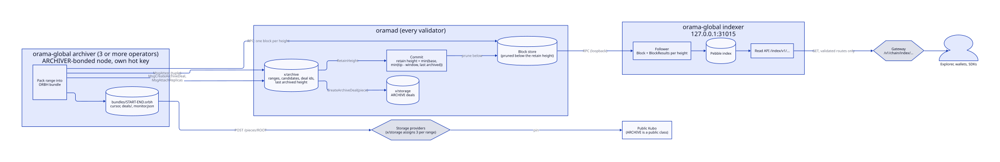
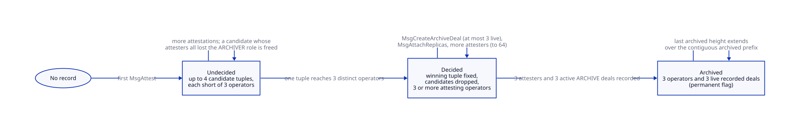
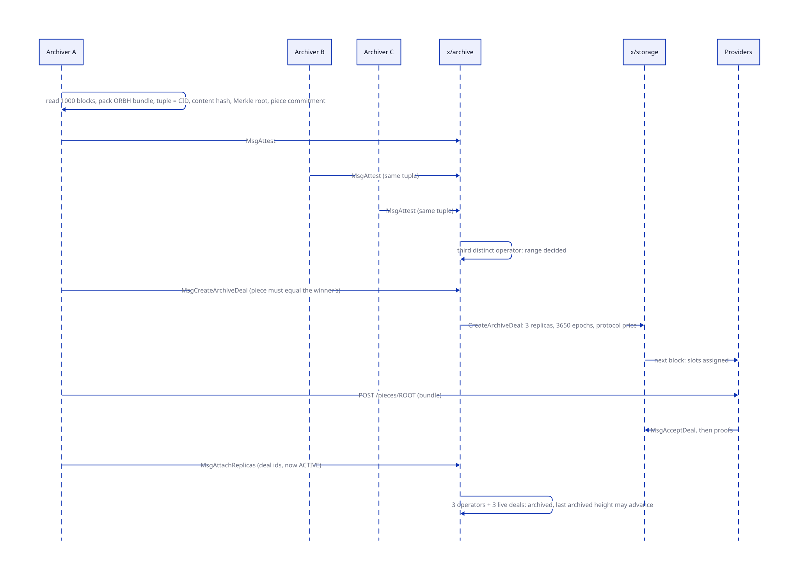
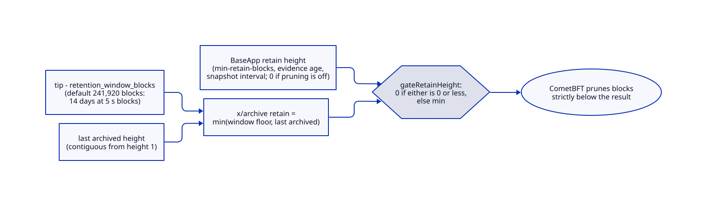
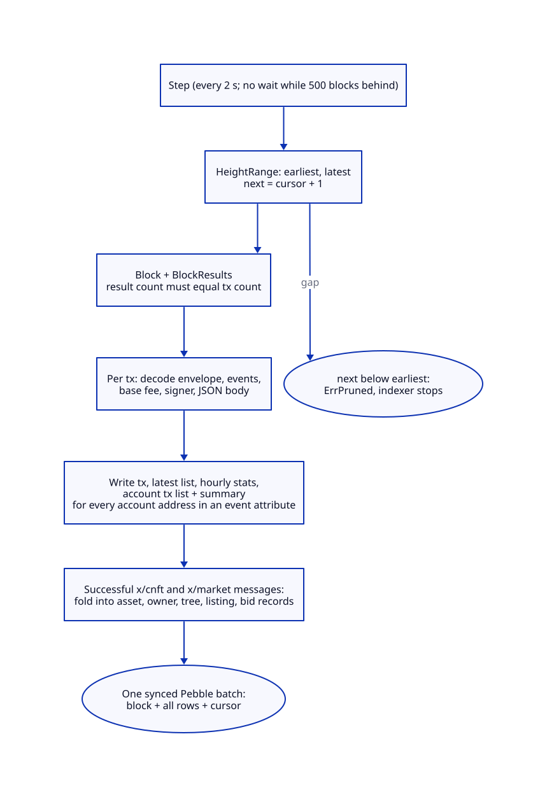

# Archive and indexer

> **At a glance.**
>
> - **What:** two services that keep the chain's history usable after validators prune it. x/archive is the on-chain registry that agrees which bundle of block hashes is the history of each fixed range of heights, requires three independent operators to attest it and three storage deals to hold it, and gates how far any validator may prune. The archiver (`orama-global archiver`) cuts the bundles, attests them, opens the paid ARCHIVE deals and uploads the bytes. The indexer (`orama-global indexer`) follows a node block by block and serves a local read index of blocks, transactions, accounts and compressed NFTs to the explorer and wallets.
> - **Key numbers:** range 1,000 blocks (`range_blocks`); quorum 3 distinct operators and 3 live deals per range; at most 4 candidate tuples per undecided range; retention window 241,920 blocks by default (14 days at the chain's 5 s blocks); bundle at most 4 GiB (`max_piece_bytes`); ARCHIVE deal 3 replicas for 3,650 epochs; indexer API on `127.0.0.1:31015`, default 20 and at most 100 rows a page, at most page 1,000; the indexer steps every 2 s and indexes at most 500 blocks per step.
> - **Code:** `chain/x/archive/`, `chain/archiver/`, `chain/indexer/`; the commands in `chain/cmd/orama-global/archiver.go` and `chain/cmd/orama-global/indexer.go`; the prune gate in `chain/app/retain.go`; the gateway route `core/pkg/gateway/handlers/chainread/index.go`.
> - **Depends on:** [storage deals](41-storage-deals.md) for the ARCHIVE deal class and its payment; [global nodes](37-global-nodes.md) for the ARCHIVER role and the hot key; [chain architecture](39-chain-architecture.md) for how modules and the `Commit` hook are wired; [NFTs and the market](45-nfts-and-the-market.md) for the messages the indexer folds into assets.



## Why it exists

A validator that keeps every block forever grows without bound; a validator that prunes loses history that explorers, auditors and new nodes need. The archive turns that into a rule the state machine enforces: blocks older than the retention window are deleted only when a range that covers them is archived, meaning that several operators who do not know each other agree on its hash and several paid providers hold the bytes.

Three constraints shape it.

- **History must agree before it is trusted.** The chain cannot look up its own past block hashes inside a transaction, so it cannot check an attestation against truth. It checks agreement instead: one tuple must be attested by three distinct operators, and a first attester cannot fix what the range is.
- **Nobody should be able to squat history or drain the ceiling.** Ranges are canonical (fixed boundaries, never overlapping); the deal for a range is priced and timed by the chain, opens only over the winning content, and is capped at three live deals per range.
- **Reading must not load the validator.** An explorer needs transactions by hash, by account and by time, and a wallet needs its NFTs. Serving those from the consensus node would put unbounded scans on the process that signs blocks. The indexer is a separate process with its own database and no key.

## The model

**Range.** A fixed span of `range_blocks` heights, starting at `k x range_blocks + 1`. The record is `RangeRecord` in `chain/proto/orama/archive/v1/archive.proto`.

**Bundle.** The file an archiver writes for a range: the blocks, each with its header hash. Format ORBH, section "The bundle".

**Tuple.** What one attestation states: the bundle CID, the bundle's SHA-256, the Merkle root of the range's block hashes, and the piece commitment of the bundle file (`Tuple` in `chain/x/archive/types/tuple.go`). Attestations are tallied per tuple: archivers that differ in any field do not count toward each other.

**Candidate.** One tuple of an undecided range with the archivers, operators and node ids that attested it.

**Decided.** A range where one tuple reached three distinct operators. The winner's fields become the range's and the other candidates are dropped.

**Archived.** A decided range with at least three attesting archivers and three recorded live ARCHIVE deals. The flag is permanent.

**Last archived height.** The highest H such that every block from 1 to H lies in an archived range (`ContiguousArchivedHeight`). A gap, or an unarchived range, stops it.

**Retain height.** The lowest block a validator must keep: `min(tip - retention_window_blocks, last archived height)`.

**Archiver.** A node with an active ARCHIVER role bond whose hot key signs the three messages. **Operator.** The account that owns the node; the quorum counts operators, not keys or nodes.

**ARCHIVE deal.** An x/storage protocol deal over a bundle ([storage deals](41-storage-deals.md)).

**Index.** The indexer's Pebble database. **Follower.** The loop that fills it. **Cursor.** The last indexed height.

### Messages and queries

| Message | Signer | Effect |
|---|---|---|
| `MsgAttest` | ARCHIVER node's hot key | adds the key's operator to a candidate tuple of a range; decides the range at three operators |
| `MsgCreateArchiveDeal` | ARCHIVER node's hot key | opens one ARCHIVE deal over the winning piece |
| `MsgAttachReplicas` | ARCHIVER node's hot key | records active ARCHIVE deal ids on a decided range |

Queries: `Params`, `Range`, `LastArchivedHeight`, `RetainHeight`. The module has no `MsgUpdateParams`, no begin or end block work and no authority address: its four parameters are fixed at genesis.

## How it works

### The bundle

`chain/archiver/bundle.go` defines ORBH version 1, which is not a CAR file. Big-endian throughout:

```text
"ORBH" | version u8 | start i64 | count u32 |
count x ( block hash [32] | length u32 | tendermint.types.Block protobuf )
```

`Encode` requires consecutive heights, a 32-byte hash and a body of at most 64 MiB per block. `Decode` parses a bundle and checks, per block, that the protobuf decodes, that its height is the expected one and that the block's own hash equals the hash stored beside it. `Verify` checks a bundle against a range record: the file's SHA-256 equals `bundle_hash`, the first and last heights equal the range, and the Merkle root of the block hashes (CometBFT's `merkle.HashFromByteSlices`, in height order) equals `merkle_root`. The bundle CID is a CIDv1 with the raw codec over the SHA-256 of the whole file, in lowercase base32 (`CID`). The range's piece commitment is computed over the same file with the same Merkle scheme as storage deals ([storage deals](41-storage-deals.md)).

### Attesting a range

The archiver loop (`chain/archiver/run.go:Step`) runs every minute (`--interval`). It reads the range width from the chain (`range_blocks`; the flag may repeat it but not differ), then, from its cursor, takes each whole range whose last height is below the tip:

1. Reads each block of the range over RPC, one call per height, and packs the bundle (`packRange`). The whole range is held in memory.
2. Builds the tuple (`tupleOf`) and writes the bundle to `bundles/START-END.orbh` through a temporary file and a rename.
3. Reads the range from the chain. If its own key already attested a different tuple, that is a conflict. If another tuple is on chain, it reads the blocks a second time (`reverify`) and, if the second read packs into the same tuple, keeps its own and attests it anyway, because attestations are tallied per tuple; if the range is already decided for another tuple it records the conflict instead.
4. Submits `MsgAttest`. A refusal because another key of the same operator attested a different tuple is recorded as a conflict once, and the cursor moves on.
5. Saves the cursor (8 big-endian bytes, atomic) and starts following the range for deals.

A conflict is written to `conflicts/START-END.json` with the local and chain values; the pass reports it and continues with the next range.

`Keeper.Attest` (`chain/x/archive/keeper/attest.go`) runs these checks in order:

- `ValidateAttestation`: addresses, heights, a printable-ASCII bundle CID of 1 to 128 characters, two 32-byte hashes, and a piece commitment whose leaf counts are the ones its byte length implies.
- `CheckCanonicalRange`: the range starts at a multiple of `range_blocks` plus 1 and is exactly that long.
- The piece is at most `max_piece_bytes`.
- `requireFinalized`: the range's last height is below the executing block.
- If the signing key already attested this range, the call is idempotent for the same tuple and an error for another one.
- `ArchiverOperator`: the node named has an active ARCHIVER role and the signer is its hot key; the answer is the operator.
- On a fresh or undecided range, candidates none of whose attesting nodes still holds an active ARCHIVER role are freed (`liveCandidates`), so departed operators cannot hold the candidate slots. Then `attestCandidate` adds the operator to the matching candidate. An operator that is already in a different candidate gets `ErrConflictingAttestation`. A new tuple when the range already holds `max_candidates_per_range` (4) gets `ErrCandidatesFull`.
- When a candidate reaches three distinct operators the range is decided: its fields become the range's, the candidates are cleared.
- On a decided range only the winning tuple is accepted, and further operators are added up to 64 archivers.



### ARCHIVE deals and archiving

After a range is decided, any attester may ask for its deals.

`MsgCreateArchiveDeal` requires: a finalized range, the signer is an active ARCHIVER's hot key, the range is decided (`ErrQuorumPending` otherwise), the signer's operator attested the winning tuple (`ErrNotAttester`), and the message's piece commitment equals the winner's (`ErrWrongPiece`). The chain, not the archiver, sets the price (x/storage's `protocol_price_per_epoch`) and the duration (`ArchiveDealEpochs`, 3,650 epochs, ten years at one epoch a day). It first drops recorded deals that ended, then refuses if the live recorded deals plus the pending ones already equal `MaxLiveDealsPerRange` (3, `ErrDealsFull`). Otherwise it calls `CreateArchiveDeal` in x/storage with the range's pinned piece, remembers the new deal as pending for the range and reserves its id so no other range can claim it. The deal is `OPEN` until x/storage assigns three providers in the next block, and an open deal cannot back a range.

`MsgAttachReplicas` records deal ids on a decided range, from an attesting operator. Each id must be an `ACTIVE` ARCHIVE deal (`ArchiveDealActive`: class ARCHIVE and status ACTIVE) that backs no other range. When the range holds three or more attesting archivers and three or more live deals, `storeRange` marks it archived, and extends the contiguous prefix if the new range closes a gap in it. A deal that ended in the meantime is dropped before the test, so the flag always holds over the ids the record lists.

The archiver does the same work off chain (`chain/archiver/deals.go:advanceRange`), each pass, for each attested range it follows:

1. Range archived: stop following. Range not decided: wait. Range decided for another tuple: record the conflict and stop.
2. Drop its own pending deals that x/storage no longer runs.
3. Open the deals the range lacks (`openDeals`) after checking that the bundle file on disk commits to the winning piece. A refusal as `ErrDealsFull` means another archiver was faster and is not an error.
4. Upload the bundle to the provider of every slot that is assigned and not yet accepted (`uploadDeals`): first the slot's assigned root must equal the bundle's, then `POST` to the provider's first http(s) endpoint in x/nodes, four tries 1, 2 and 4 seconds apart, remembering `deal/slot/node` so a restart does not send it again. A slot the chain moves to another node is a new key.
5. Record the deals that have become `ACTIVE` with one `MsgAttachReplicas`.

The deal state is a JSON file per range, `deals/START-END.json`, written atomically.



### Paying for history

An ARCHIVE protocol deal claims its full price from the epoch's storage ceiling for every proved slot, and the archive fund covers any shortfall left after the ceiling's pro-rata cut ([storage deals](41-storage-deals.md), "Closing an epoch"). There is no owner and no escrow. At the default protocol price of 1,000 norama per replica per epoch, one range costs 3 x 3,650 x 1,000 = 10.95 million norama over its ten years, about 0.011 ORAMA, and at 14,400 blocks a day the chain starts about 14 ranges a day.

### Pruning

CometBFT deletes blocks below the retain height `Commit` returns. `OramaApp.Commit` (`chain/app/retain.go`) lets BaseApp compute its usual retain height (from `min-retain-blocks`, the evidence age and the snapshot interval; zero when the operator has not turned pruning on) and then lowers it to x/archive's. `gateRetainHeight` returns 0, meaning prune nothing, when either value is not positive, and the lower of the two otherwise.



x/archive's own retain height is `min(tip - retention_window_blocks, last archived height)` (`types.RetainHeight`). Two properties follow from the formula and are tested: a stalled archive keeps the retain height pinned to the last archived block however far the tip runs ahead (`TestRetainHeight_stallForAYearStaysAtLastArchived`), and when the archive is caught up, blocks inside the 14-day window stay even though they are archived (`TestRetainHeight_fourteenDayWindowBindsWhenArchiveIsCaughtUp`). `PruneAllowed` states the same rule per height. The default window is 241,920 blocks, 14 days of the chain's 5-second blocks (`chain/x/archive/types/constants.go`, from `params.BlockIntervalSeconds`, [chain architecture](39-chain-architecture.md#block-interval-and-measured-performance)). Genesis accepts no window under that default (so the window cannot be set shorter than 14 days of the chain's blocks) and none over 1,209,600 blocks (14 days of 1-second blocks).

### Reading history back

`orama-global history get --height H --from SOURCE --out FILE` finds the range that holds H, loads the bundle from an archiver's home directory or from an http(s) base that serves `bundles/START-END.orbh`, runs `archiver.Verify` against the range record on chain, and writes that block's protobuf to a file; a bundle that does not verify writes nothing. Nothing in the repository serves the HTTP form: a bundle is also held by three providers as a piece, fetchable from them as `GET /pieces/ROOT`, and, because ARCHIVE is a public class, pinned in the public Kubo of each.

### The indexer

`orama-global indexer` (`chain/cmd/orama-global/indexer.go`) follows oramad over its loopback RPC and keeps a Pebble database in `home/index`. It starts at `--start-height`; the default, 0, is the start height the index already has, or, for a new index, the earliest block the node still serves (`indexer.ResolveStart`), so a node that pruned the chain's first blocks (an archived range, or a state-synced node) does not refuse a new index at height 1 on every start.

**One block, one batch.** `Follower.Step` (`chain/indexer/follower.go`) reads the node's earliest and latest heights, indexes at most 500 blocks after the cursor, and for each block reads `Block` and `BlockResults`. The result count must equal the transaction count. Each transaction is written with its code, log, gas, events, the signer (the first signature's account, empty for a shielded or undecodable transaction), the memo and its messages as JSON. Failed transactions are indexed too. The injected extended commit that starts every block from the height inclusion lists switch on is not a transaction (its bytes are no Cosmos transaction by design), so the index skips it and the block's count, hashes and transaction list leave it out. The other transactions keep the index CometBFT gives them in the block, so the first one of such a block is at index 1: each stored transaction keeps its real index, and `tx_hashes[i]` is the transaction stored at index `i + 1`. Per transaction the index also writes: a newest-first list, an hourly bucket (count, failures, base fee burned), and, for every account address that is the whole value of an event attribute, an account-to-transaction entry and a summary row (count, first and last activity). The block row and the cursor are committed with the transaction rows in one synced Pebble batch, so a crash leaves the previous block, never half of one (`chain/indexer/batch.go:commit`).



**Aggregates.** The explorer's epoch, supply, validator and long-range figures are computed once, in the same batch as the block (`chain/indexer/agg_*.go`), and the read API only reads them. The follower closes an epoch at the block whose finalize events carry x/emission's `emission_epoch_closed` (the epoch that closed, the blocks it held and the time it began), because the boundary depends on params the chain can change and on state a node stops keeping (`chain/indexer/agg_boundary.go`). It checks the event against its own count (the epoch it follows, the blocks since that epoch's first block, the start time), and when the state is readable the epoch counter must be one higher and started at that block's time, or the follower stops. The rule for blocks of a binary that emitted no such event is the old one: the first height at which the follower saw the event is recorded (`m/epoch-events`); before it the follower applies x/emission's closing rule (the duration and minimum block count the epoch began under) to each block's time and height and asks the chain only at a block where an epoch can close, and from it on only the event closes an epoch, so a params change during a window whose state was pruned cannot move a boundary. A boundary of the older binary taken from a rule that changed in such a window cannot be recovered from anything the chain still keeps; the close that follows it, once its state is readable, stops the follower. At that closing height it stores: the epoch row (start and end height and time, and the change since the previous closing height in x/emission's cumulative minted, service, development, faucet and burned totals and in x/fees' collected, burned and distributed counters, plus what the closing block's bank events show x/power credited to earnings and force-bonded); a supply point (bank supply and the balance of every module account, grouped into bonded, unbonding, earnings pools, storage escrow and the rest); and for each validator its voting power (x/power) and status (x/staking). Signing is counted per block from the commit the block carries, read against the validator set that signed it (CometBFT's `validators`, fetched again only when the set's hash changes), and slashes and jail periods come from x/slashing's events and successful `MsgUnjail` transactions. Transaction statistics are kept for hours, days and weeks. A block already folded in is skipped, and an index that begins inside an epoch computes that epoch's start exactly from x/emission's block count and marks it `partial`. The reads need the chain's state at the heights they ask, and the installer's nodes keep only the last 100 states (the next paragraph). What each validator and delegator was paid is read from events, not state (`chain/indexer/agg_rewards.go`). x/power emits `power_validator_reward` once per paid validator in the epoch-closing block (the validator, its amount, its commission, the operator's share, the delegators' share and the part force-bonded; `operator_share + delegators = amount`) and `power_delegator_reward` for each delegator other than the operator that was credited (`chain/x/power/types/events.go`, emitted by `distributeValidatorReward`), on the validator's own cache branch, so a reward that was rolled back reports nothing. The follower reads them from the closing block's finalize events and holds them against the bank transfers x/power made in the same block: the validators' amounts must add up to what was credited to earnings and force-bonded, a validator's delegator credits to its delegators' share, and each split to its amount, or the block is not indexed. It stores a row per epoch and validator, the same row in the validator's history, and a row per credited account (a delegator, or an operator's own share), and the epoch row says `rewards_recorded` with the commission, operators' and delegators' totals. An epoch whose closing block moved reward coins and carried no such event closed before the chain emitted it: it is `rewards_recorded: false` and the reward routes list nothing for it, so a missing figure is never a zero; an epoch that paid nothing is recorded with zero totals. Because the events are not state, an epoch that closed as unavailable still has its payout. The chain still exposes nothing for the split of service mints between storage and relay, so the index does not claim it.

**State the nodes prune.** The installer sets every node to keep 100 states and prune every 10 blocks (`core/pkg/install/chainconfig.go`), while it keeps blocks far longer, so the indexer can read a block it can no longer read the state of. It never invents a figure for one. Three rules follow.

- *The aggregates begin at the first height whose state the node has.* Before it takes a block into the aggregates, the follower reads x/emission's epoch state at that block's height. If the node answers that it no longer holds that state, the block is indexed (block, transactions, accounts, cNFTs, statistics) and left out of the aggregates, and the follower asks again at the next block. The first height that answers is the baseline: the epoch in progress there is marked `partial` unless the block closed an epoch, and `/index/v1/status` reports the height as `aggregates_from` (0 until it exists). Epochs that closed before it are not in the index, the same as for a later `--start-height`.
- *An epoch that closed while its state was gone is unavailable.* When the follower has fallen behind, or was down across a close, the node has pruned the state of the closing height. The follower still closes the epoch by x/emission's rule, which it keeps from the last time it read the chain, and stores the row with `unavailable: true`, its `unavailable_reason`, its start and end height and time, and no figure. The epoch's validator rows and supply point are not stored (both are state), and its signing tallies are dropped. The next epoch begins right after, with its starting totals unknown. At the next close whose state is readable, the follower checks the epoch counter and start time against the chain as for every close, stores that epoch's supply point and validator rows (exact: they are the state of that height and the tallies of every block of the epoch) and its row as unavailable too, because its change in the chain's totals runs from a height it never read, and reads the totals there as the start of the epoch after it, which is exact again. The index therefore never puts the change over several epochs on one epoch. `GET /index/v1/validators` answers the validators of the newest epoch that has validator rows, and each row names its epoch.
- *Pruned state is told from every other failure by the node's answer, not by its words.* baseapp answers a query at a height it cannot load with `sdkerrors.ErrNotFound` (code 38, codespace `sdk`) and a log that begins `failed to load state at height N;` followed by the store's cause: an IAVL version that was pruned, or no commit info for a height below the node's first (a state-synced node). A gRPC `NotFound` of a module is `ErrKeyNotFound` (code 22), so it cannot be taken for it. `node.QueryError.StatePruned` (`chain/client/node/node.go`) requires the code, the codespace and the beginning of the log, and `chain/client/node/pruned_test.go` checks it against the error a real multistore returns for a pruned version. Any other failure of a query (a node that is unreachable, a record that is missing, a state the indexer cannot decode, an epoch boundary the chain disagrees with) stops the block as before.

A pass that fails leaves the cursor where it was and retries. While it fails, `/index/v1/status` carries `stuck`: the height of the block, whether it is a pruned state (`state_pruned`, which no retry changes), when the failures began and how many passes failed. The error itself (`reason`) names the chain's addresses and the node's state, so it is served only on `/index/v1/operator/status` (`chain/indexer/api.go:serveStatus`), a route the gateway's allowlist does not proxy; the follower logs each failing pass (`indexer pass failed`) with the same fields. A pass that works clears it. The node report reads the operator status while the unit is active (`core/pkg/telemetry/report/global.go:readIndexerStatus`), `orama status` shows the indexer's block and, if it is stuck, the block and the reason, and the health check raises `global.indexer.stuck`. Two lookups can still need the state of the block before a transaction, and so can leave the follower stuck on a node that pruned it: the consensus key of a validator an unjail names that the registry has not seen, and the record a settle or a compress consumed when the transaction ran on a chain binary that did not yet emit the event that reports it (below). Both are reported as `state_pruned` when they happen.

**Shielded actions.** For a wallet that scans the pool, the follower records every Orchard action of every committed shield, shield of earnings, transfer and unshield (`chain/indexer/shielded.go`). A message handler reads the bundle with `bundle.CompactActions` and keeps, for each action, the nullifier, the note commitment, the ephemeral key, the first 52 bytes of the encrypted note (the ZIP-307 compact ciphertext), the 80-byte out ciphertext and the transaction hash; at the end of the block it writes them under the block height, the transaction's index and the action's index, each with the leaf position its commitment took, and the tree size after the block. The positions are read from events, never from state: the chain's `shielded_bundle` event for each message carries the tree size before the bundle's append and the number of commitments it appended, so the bundle's actions take the leaves from that size on (the follower finds the event whose `msg_index` is the message's, and a committed shielded message with no event, two, or a count that is not the bundle's actions stops it). The follower checks continuity: every action's position follows the last, within a block and from block to block, and a gap or an overlap stops it with the leaf it found and the leaf it held. The first block with an action the index sees sets where its positions begin, since an index may begin inside the chain's history. It asks the chain nothing about the tree, so a node that pruned its state serves the same positions as one that kept it. A bundle the chain accepted that `CompactActions` refuses stops the follower, since it means the index and the chain disagree about the format. The roots of filled 2^16-leaf subtrees come from the chain's `shielded_subtree_complete` events (the chain also keeps them in state and serves them from the `SubtreeRoots` query, complete from the first subtree; the index serves what it saw, and a test builds two real subtrees through the chain and finds the same roots in both), which the follower holds against the positions it read: the event's subtree must be one the block filled, indices must run on without a skip, and once the chain has reported one a subtree that fills without its event stops the follower, as a settle without its event does. The first one the follower sees sets `first_index`; an index that began after earlier subtrees filled, or on a chain from before the event, has no root for them, and says so. `/index/v1/shielded/actions` and `/shielded/subtree-roots` read them.

**cNFTs.** The follower rebuilds asset state from the message bodies and their responses, the way the chain rebuilds a leaf from the transaction that wrote it. A table of twelve handlers (mint, transfer, burn, update metadata, decompress, compress, create tree; list, bid, cancel listing, cancel bid, settle) updates asset, owner, tree, listing and bid records. A settle and a compress consume a record the message does not carry (the listing and the bid, the decompressed asset) and delete it, so the chain reports it: x/market emits `market_settle` (listing, bid, tree, leaf index, asset id, buyer) and x/cnft emits `cnft_compress` (asset id, delegate, metadata CID, creator hash, hash id, new tree and leaf index), each at the end of its handler so a failed message emits nothing. The follower takes them from the events of the same transaction, picks the one whose `msg_index` is the message being applied, and refuses an event that disagrees with the message or response it came with (`chain/indexer/chain_events.go`). It never reads state for a settle or a compress that carries its event, so an index that starts after a record was created can still index its consumption on a node that pruned the state.

A chain that ran a binary without these events has settles and compresses that carry none. The rule that tells them apart is deterministic and needs no version number: the follower records the first height at which it saw either event (`m/events` in the index). A settle or compress without its event before that height ran on the older binary, because the first one after the chain moved to the newer binary carries its event; it is resolved as it always was, from the index and else from the state at the previous height (`queryBefore`), and a node that pruned that state fails the block, so the block is not indexed. From that height on, a settle or compress without its event is an error that stops the follower: the index does not read state to cover for it. Every indexer of the chain therefore decides the same for every block it reads, whatever height it started at. An asset is keyed by id, tree and leaf index, and one id may have several records, because the chain does not make asset ids unique across mints. The answer shape follows the DAS `getAsset` layout with only the fields x/cnft has.

**Refusals instead of gaps.** If the next block to index is below the node's earliest block, the follower stops with `ErrPruned` and the process exits; it never skips. An index remembers the start height it was created with and refuses another; it carries a layout version (5: 3 added the aggregates, 4 the per-epoch rewards, 5 the shielded actions and subtree roots) and refuses an index written by another version. Both mean "index again into a new `--home`". A successful transaction the decoder cannot read stops the block, since a block holds only what the application accepted.

**The read API** (`chain/indexer/api.go`) is GET only under `/index/v1/`, with a closed set of routes and query parameters:

| Route | Returns |
|---|---|
| `status` | start height, cursor, node earliest and tip |
| `home` | the explorer's home page in one answer: the status with the lag, the newest 24 blocks and 12 transactions, 48 hourly buckets, the epoch in progress, the supply and base fee at the tip, and example targets |
| `blocks/HEIGHT` | one block row |
| `blocks` (`page` or `cursor`, `limit`) | a page of blocks, newest first, without their transaction hashes, with each block's commit tally |
| `txs` (`page` or `cursor`, `limit`, `filter`) | a page of transactions, newest first; `filter` is `all`, `failed`, `transfers`, `staking` or `storage` |
| `txs/HASH` | one transaction |
| `stats` | 48 hourly buckets |
| `accounts/ADDR` | the account summary |
| `accounts/ADDR/txs` (`page` or `cursor`, `limit`, `filter`) | that account's transactions, newest first |
| `accounts/ADDR/rewards` (`page` or `cursor`, `limit`) | what x/power credited the account, newest epoch first, and `recorded_from_epoch` |
| `shielded/actions` (`from_height`, `limit` 1 to 1,000) | the blocks with shielded actions from a height, whole blocks within the limit, each action with its position and each block with the tree size after it; `next_height` and `has_more` page it |
| `shielded/subtree-roots` (`start_index` from 0, `limit` 1 to 1,000) | the roots of the filled 2^16-leaf subtrees, each with the block that filled it, and `first_index` |
| `cnft/assets/ID` | the records of one asset id (at most 100) |
| `cnft/owners/ADDR/assets` (`page` or `cursor`, `limit`) | the assets an address holds, in asset id order |
| `epochs` (`page`, `limit`), `epochs/N` | the closed emission epochs, newest first; one epoch |
| `epochs/N/validators` (`page`, `limit`) | the validators of a closed epoch, highest voting power first |
| `epochs/N/rewards` (`page`, `limit`) | what a closed epoch paid each validator, and whether the epoch's payout is recorded |
| `supply` (`page`, `limit`) | the supply breakdown, one point per closed epoch |
| `validators` (`page`, `limit`), `validators/OPERATOR` | the validators of the newest closed epoch; one validator |
| `validators/OPERATOR/epochs`, `/slashes`, `/jails`, `/rewards` (`page`, `limit`) | a validator's per-epoch rows, slashes, jail periods, and each closed epoch with what it was paid or that the epoch is not recorded |
| `stats/hourly`, `stats/daily`, `stats/weekly` (`page`, `limit`) | transaction statistics, newest first, with no holes |

A path that is not clean, an escaped path, an unknown or repeated parameter, a `filter` outside the five names, or a value outside `limit` 1 to 100 and `page` 1 to 1,000 (1 to 10 on the five lists that grow with the chain or that one account can make long, below) is refused.

**Cursors.** The transaction list, an account's transaction list and the block list (the lists that grow with the chain), and an owner's assets and an account's rewards (the lists one account can make long: anyone can mint many assets to one owner), are paged by position, not by number: a numbered page makes the index skip every row before it, so page 1,000 at 100 a page iterated 99,900 rows, and a row that arrives while a reader pages shifts every page after it. A full page carries `next_cursor`, the position of its last row, and `cursor=<it>` on the same route returns the rows strictly older than that position by seeking there, so a page costs the page at any depth and no row is repeated or missed (`chain/indexer/cursor.go`). A cursor is exactly 16 characters of the URL-safe base64 alphabet (unpadded, no `=`) for 12 bytes: the block height (8, big-endian, from 1) and the transaction's index in its block (4, big-endian; 0 on the block list). `ParseCursor` refuses any other length, any other character, a height of 0 or above 2^63-1, and a block-list cursor with a non-zero index; a repeated `cursor`, `cursor` with `page`, and `cursor` on any other route are refused. A cursor is a position and not a secret: a forged one reads a page of the list from where it points and no further. `page` stays for the numbered pages the lists still offer, up to `MaxListPage` (10). A short page has no `next_cursor`, which is how a reader knows it is the last. An owner's assets and an account's rewards are not ordered by block position, so their cursors are the key of the last row after the list's prefix (`chain/indexer/cursor_keys.go`), and the next page seeks past it (`scanAfter` for the assets, in key order; `scanBefore` for the rewards, which are read newest first). An owner's assets cursor is exactly 59 characters for the 44 bytes of the asset's location, the owner index's key suffix: the asset id (32), the tree id (8, big-endian) and the leaf index (4, big-endian); every 44 bytes are a position, and the same id minted again at another tree or leaf sorts after it by tree then leaf. An account's rewards cursor is 39 to 580 characters for the epoch (8 bytes, big-endian, from 1) and the validator operator address as text (21 to 427 bytes, the rest of the rewards index's key), and `ParseRewardCursor` refuses an epoch of 0 and an address that is not a canonical validator operator address; two validators that credited one account in one epoch are told apart by the address, so a page may end between them. Each list refuses the other's cursor. The listener must be a loopback IP or, on a host that also runs a cluster node, the namespace address `198.18.0.2`; `requireLocalOnly` refuses anything else. The gateway's `/v1/chain/index/` route forwards to it after validating the same shapes again, building the upstream path itself and never forwarding the caller's path; the route is open to callers without a credential, and it has a per-client bucket of its own (1,200 a minute, burst 240) beside the general one, and at most 32 index reads are in flight on a gateway (`chainread.indexMaxConcurrent`), because a page deep in a list makes the indexer skip the rows before it.

**Reads that cost the page.** A transaction is written under `all` (the newest-first list and each account's list) and, besides, under one key per filter it matches: `failed` when the chain refused it, and `transfers`, `staking` or `storage` for each kind of message it carries, globally and for each account its events name (`chain/indexer/tx_lists.go`). A page of a filtered list is a reverse scan of that prefix, skipping the rows before the page, and then the transactions it names, read from one snapshot. The kind of a message type is `chain/indexer/message_kinds.json`, embedded in the indexer and held by a decoder test (`website/src/explorer/data/chain/decoders/kinds.test.ts`) to the category the explorer shows the message under, so the filter and the page cannot drift. The block list is not scanned: the index holds every block from its start height to its cursor, so a page is read by height. `home` is built once per cursor and per two seconds behind a single flight (a build under way is waited for, a failed or panicking build is not kept, a node that cannot be read is a 502), and carries `stuck` without its `reason`, which `status` keeps for the operator because an error can name the node's addresses: the index's part is one snapshot of the index, and the epoch in progress, the supply and the base fee are queries at the node's tip, which need no index. Every block row carries the votes of the commit it holds for the block before it (`commit_signed` of `commit_size`).

**Cache headers.** A 200 from a head-dependent route is `Cache-Control: public, max-age=2` and one from a route that cannot change once it exists (`blocks/HEIGHT`, `txs/HASH`, anything under `epochs/N`, and a page of the shielded routes that has more behind it) is `public, max-age=600`; errors are `no-store` (`chain/indexer/cache.go`). Ten minutes is the ceiling on purpose: a network that starts again reuses its heights and epoch numbers, and the URL names no chain. The gateway keeps exactly those two forms, up to an hour, and answers every other chain route and every error `no-store`.

**Measured at scale.** `BenchmarkIndexAtScale` (`chain/indexer/bench_test.go`) writes an index of a million transactions, 100,000 blocks, 20,000 accounts and 500 epochs of 100 validators as the follower would leave it (644 MB, 32 s), and reads each route through the handler on an Apple M3 (`go test -run '^$' -bench BenchmarkIndexAtScale -benchtime 300x ./indexer/`; the figures move by a factor of two between runs on a busy machine). The first page of the newest transactions, of a filter or of an account's list is 0.4 to 1.8 ms; one transaction or block by key 45 microseconds; the first 24 blocks 0.19 ms and the last page of the block list the API allows (page 1,000 of 100) 1.4 ms, because blocks are addressed by height; `home` 54 microseconds from its cache and 4.8 ms rebuilt, which happens once per block; a page of 100 rewards 0.2 ms. The last page of a transaction list the API allows (page 1,000 of 100) is 18 to 38 ms, because a page of a list is reached by skipping the rows before it.

### The explorer

The website explorer (`website/src/explorer`, mounted at `/explorer`) reads the chain only through the gateway's chain proxy. It does not ask for the head: the gateway pushes it (`GET /v1/chain/head/stream`, `core/pkg/gateway/handlers/chainread/head.go`). One reader per gateway asks the node's status once a second while any page listens, and tells every open stream `event: head` (`{height, time, chain_id}`) when the height or the chain id changes and `event: unavailable` once when the node cannot be read; a stream opens with the current head, needs no indexer, ends after 100 seconds (the server's write timeout is 120) so the browser's `EventSource` reconnects, and is bounded at 1,024 per gateway (503 with `Retry-After` beyond) and, per client network, by a bucket of 12 opens a minute (burst 6) and four open at once (`holdLimiter`; a refused stream takes nothing). A stream the gateway refuses is not retried by the browser, so the explorer's feed opens it again after a wait that doubles from 5 to 60 seconds. A browser with no `EventSource` is told so and does not poll: the per-reader status request every three seconds that the stream replaced grew the node's load with the readers, and a timer fallback would bring it back. The browser's cache follows the headers above (`fetch` is no longer `no-store`), the home page's tiles, blocks and feed share one `index/home` read, and the page says how far the index is behind the chain from the same answer. The page is static and is served from `orama.network`, which has no chain behind it, so the reader's browser calls a network's own gateway across origins (`https://stagenet.orama.network/v1/chain/...` by default; `DEFAULT_GATEWAY_ORIGIN` in `data/chain/client.ts`, a plain GET with no credentials and no custom header, so there is no preflight). Which gateway is read is the URL's network (`network/`): the networks of the repository's `networks/` directory whose chain exists (the build bundles their manifests, the same files it publishes at `/networks/<name>/`), with the gateway derived from the manifest's seeds because the manifest has no field for it (nameservers `nsN.<domain>` give `https://<domain>`, any other seed is a gateway itself), and a custom gateway the reader names, validated by `chainBase` and confirmed by the reader before a link may make the browser call it. The default network keeps the unprefixed URLs (`/explorer/tx/<hash>`), another registry network is `/explorer/<network>/...`, a custom one `/explorer/custom/...?gateway=<origin>`, and every page's URL also carries `?chain=<chain id>` once the gateway has answered. Three chain ids can disagree after a reset (a new chain id, block 1 again): the registry's, the gateway's `status` and the URL's. The head carries the gateway's chain id (it arrives over the head stream, above), so a reset seen while a page is open is announced although the height went down; registry against gateway shows a banner and the gateway's chain, URL against gateway replaces the page with a reset page, since nothing the old link names exists. The website host does not proxy `/v1/`: a proxy would present every reader to the gateway as the host's one address and put them all in one rate-limit bucket (`clientkey` trusts `X-Forwarded-For` only from the gateway's own reverse proxy), and it could not serve a network it was not configured for. The gateway lets the explorer in by a narrow CORS rule (`core/pkg/gateway/cors_explorer.go`): the origin `https://orama.network`, exactly, on a `GET`, `HEAD` or a preflight for one under `/v1/chain/`; no other origin outside the network's base domain, no other route and no credentialed answer. It carries no demo data and no fixture accounts: when the proxy or the indexer is down a page shows an error box and nothing else, and without the indexer the transaction, block and wallet pages fail. Pages call only the `ExplorerDataSource` interface (`website/src/explorer/data/source.ts`), whose one implementation is `data/chain/`: a lookup for something that does not exist resolves to `null`, never an invented record; a real failure rejects with a readable error; pagination is cursor-based and a bad cursor is rejected; limits are clamped; a figure the chain cannot give is absent and the page leaves it out. An epoch row the indexer stored as unavailable (above) is a type of its own in the explorer (`UnavailableEpochRow`: heights, times, the payout split the indexer keeps, and the reason, and no figure), parsed strictly: an unavailable row that carries a figure, or a recorded row that lacks one, is a read error. The epoch, epochs, rewards, emission and supply pages show it as "not available" with the indexer's reason, never as zero, leave it out of every sum, and draw it as a gap in a chart (an epoch with no supply point is a gap in the supply series). The folders are `model/` (domain types, ORAMA and norama formatting, what a pasted string is with a bech32 checksum check, the investigation trail, and how a transaction reads as a sentence), `data/`, `ui/`, `shell/` (header, search palette, trail bar, preview drawer) and `pages/` (home, transaction, block, wallet, validators, validator, epochs, epoch, rewards, emission, economics, nodes, node, storage, tor, and tokens, NFTs, contracts, market, governance and the shielded pool).

| Shown | Read from |
|---|---|
| Head, chain id | the head stream, `GET /v1/chain/head/stream` |
| Supply, base fee, epoch, burned fees, transaction counts, the newest blocks and transactions, the indexer's lag | the indexer's `home` (one read; the supply, base fee and epoch are the node's at its tip) |
| Validators, power, committee seats, lambda, total bonded | the staking validators, CometBFT `validators`, the power `BootstrapCommittee` and `Lambda` queries and `staking/pool`; a validator's consensus address is the first 20 bytes of the SHA-256 of its ed25519 key, computed in the browser |
| A transaction | the indexer's record (signer, memo, body, events, code, log); the fee is the `base_fee` and `tip` of the `tx` event, and "balances before and after" is built from the `coin_spent`, `coin_received` and `burn` events, so it leaves out what moved through an earnings account |
| A wallet | the bank `AllBalances` and the staking delegation queries of the wallet-query route (norama only) and the indexer's account summary; a wallet with no transaction and no funds is not found |
| A wallet's activity and counterparties | the indexer's per-address transactions, 100 a page (cursor `page:position`); staking, storage and failed are the indexer's own lists, received, sent and one counterparty are decided in the browser; counterparties come from the newest 100 transactions only |
| Rewards | the epoch rows' totals, `epochs/N/rewards`, `validators/OPERATOR/rewards` and `accounts/ADDR/rewards` (followed by cursor, 20 a page), and a wallet's earnings balance from x/fees' `Earnings` query; an epoch marked `rewards_recorded: false` is shown as not recorded, never as zero |
| Nodes, roles, bonds, declared ASN | x/nodes `Nodes` (every node, 100 a page, by page key, at most five pages) and `Params`; one node adds `Node`, `NameOfNode` and `NodeUnbondings` |
| Storage deals, replicas | x/storage `Deals` (the newest page, newest first), `Params`, `Slot` per replica when a deal is opened, and `Queue` |
| Storage providers and capacity | the nodes with the storage role: declared and reserved capacity are fields of the node |
| Block archive | x/archive `Params` and `RetainHeight`, and `Range` for the oldest four canonical ranges after the archived prefix |
| Tor relays, authorities, rewards | x/relay `Relays`, `Params`, `Reporters`, `EpochResult` of the newest epoch past its report window (two before the current one, from x/emission `CurrentEpoch`; x/relay settles epoch e in the first block of e+2), and the nodes with the relay, exit and directory-authority roles |

Every message the chain registers has a decoder (`website/src/explorer/data/chain/decoders/`, one file per module, indexed by type URL): all of x/nodes, x/storage, x/archive, x/relay, x/token, x/cnft, x/market, x/houses, x/fees, x/emission and x/shielded, and the standard bank, staking, distribution, slashing, feegrant, upgrade, evidence, consensus, auth and CosmWasm messages (x/power has no transaction message; authz is not wired). A decoder turns the message body the indexer serves (protojson with the proto field names) into a sentence in two tenses, "Alice bonded 2.5 ORAMA on node n1 for the storage role" when the transaction succeeded and "Alice tried to bond ..." when the chain refused it, plus labelled fields; it states only what the message says, so a CosmWasm call names the contract, its single entry point and its funds and nothing about what the contract did, a reward withdrawal states no amount (the message carries none), and a shielded message's sentence says only that it was submitted and the size of its proof bundle (the transaction page adds what the `shielded_bundle` event makes public, below). Norama bank sends, staking delegate and undelegate of norama, and `MsgCreateDeal` of a private or public class keep their dedicated shapes (the deal amount is the escrow: price per epoch times replicas times epochs); a send or stake of any other token is shown as the coin it names. A type with no decoder (a third-party type, or one the chain has not registered) is shown by its type URL, and a signer-less transaction (a shielded one) has no signer. A test fails when a message in `chain/proto/orama/*/v1/tx.proto` (the `service Msg` rpcs) or in the chain app's interface registry (pinned in `chain/client/tx/testdata/registered_msgs.json` by a Go test) has no decoder, and decodes each registered message's all-zero JSON to prove every decoder reads only fields the chain writes. Not shown, because nothing on chain gives it: a wallet's balance over time, the number of a validator's delegators, claimable rewards (rewards are credited to earnings automatically). What each validator and delegator was paid is shown for the epochs the chain reported it in, and those before are marked not recorded.

The token, NFT, contract, market, governance and shielded pages (reached from the header's Browse menu; URLs in `model/assets-routes.ts`, reads in `data/chain/` behind `ExplorerDataSource.assets`) read the module queries of `/v1/chain/query/` and the indexer, and they show what the chain has and say where it has no list. The modules of x/token, x/market, x/houses and x/cnft have point queries only, so: tokens are the bank's `factory/<creator>/<name>` denoms from `TotalSupply` (the bank's store is sorted, so the run of them ends at the first denom past the prefix) with a token's holders from `DenomOwners`; collections and proposals are numbered from 1 and never deleted, so the newest id is found by asking whether 1, 2, 4, 8 … exists and halving the gap (`newestId`, about twice log2 of the count in queries; the newest id and every record read are remembered for 15 s, since a page of ten costs ten of a reader's 120 module queries a minute), and a page of ten is read id by id, newest first; a listing and a bid exist only while open and are opened by number; a code, a contract and its history and raw state come from wasmd's queries, and the contracts an address created from `ContractsByCreator`. An NFT owner's assets and an asset's records come from the indexer's cNFT routes; the chain stores only a metadata content id, and the page shows it without fetching the document. Each page also shows the part of the newest 100 transactions that carries its module's messages, marked as a window. Text a creator wrote (a token's name, a collection's name, a contract's label, a message's text) is cleaned and cut like a moniker; a contract's key or value is shown as text only when it is printable ASCII, else as hex or by size. A proposal's content is read with the same `Reader` the message decoders use (`governance-content.ts`), and its decimals with `legacyDec`.

Privacy is shown by what the chain exposes. A transaction's privacy is the most private of its messages (`model/shielded.ts`): `MsgShieldedTransfer` is private, `MsgShield`, `MsgShieldEarnings` and `MsgUnshield` are the pool's public edge, everything else is public; a bank send gets a `Public` mark. For an accepted bundle x/shielded emits `shielded_bundle` with `kind`, `actions` and `amount` (the bundle's value balance: a private transfer's fee, the amount shielded, the amount unshielded), which the explorer reads from the transaction's events. A private transfer's page replaces the "where the money went" picture with an "on chain / not on chain" card and shows its fee as paid from the pool, since the `tx` event of a signer-less transaction carries no fee. The pool's module account (`orama12hms2jejlyt5tdnalles8vzp97srs3q7kg7yrq`, `authtypes.NewModuleAddress("shielded")`, also the signer-less address) is named "Shielded pool" wherever it appears; its bank balance is the pool plus the unshield queue (the gateway withholds `Pools`), `TreeState` gives the tree and nullifier counters (one per action of every accepted bundle, not a count of notes), and the indexer's transactions of that account are every shield, unshield and private transfer (each burns its fee from the pool). Volume on the page is the total of the transactions shown; no running total exists, and the turnstile is stated as the module's rule, not measured. A wallet page says it covers public activity only.

The validator pages read four sources and show nothing else. The staking list (the one REST route of the proxy) gives each validator's status, jailed flag, commission rates, total bonded tokens and description; the operator's self-bond is the Delegation query of the operator wallet to its own validator, and the delegator count is not shown because the proxy serves no validator-delegations query. x/power's `Lambda`, `Params` and the staking pool give the hand-over: lambda, the bonded stake against `bootstrap_exit_stake`, the emission epoch against `bootstrap_deadline_epochs`, `pre_gate_lambda_cap` and the cap in force (`current_cap_bps`, with `cap_fraction_normal`, `cap_fraction_reduced` and `cap_step_down_validator_count`). Lambda is the larger of two terms that no query returns, so the page shows the two figures, and the chain does not say whether the validator-count gate has been met. The operator a validator's stake counts under for the per-operator cap (`ComputeOperatorCappedShares`) is the `operator` of `ValidatorPower` (an x/nodes operator account, or the shared `unlinked` bucket), one query per validator, so the page looks up the largest 24 active validators, six at a time (the gateway runs at most 16 module queries at once, and gives a client network a burst of 30), keeps the answer for 30 seconds for the validators page and every validator's page, and counts the rest; `ValidatorPower` returns zero for its share fields (only the CometBFT power is computed in a query), and the page does not use them. The cap bounds the stake-backed part of a validator's power, `P = (1 - lambda) * bootstrap + lambda * capped`, so an operator's combined share can exceed it while the committee holds power. Signing, slashes, jail periods and the voting-power history are the indexer's per-validator routes (`index/validators/<valoper>/epochs|slashes|jails`, one page of 60, 50 and 20 rows, newest first) and the newest closed epoch of every validator (`index/validators`): uptime is signed over signed plus missed blocks, summed over the epochs shown, never an average of percentages, and an epoch with no commit for the validator has no uptime. A node without an indexer answers those routes with a 503, which a validator page shows as the error of its indexer sections while the staking and x/power sections still show. Module-query decimals arrive unscaled (`"36900369003690037"` is 0.0369, 18 places) and the staking REST list writes them with a point (`"0.100000000000000000"`); `legacyDec` in `data/chain/wire.ts` reads both.

The Nodes, Storage and Tor pages (`/explorer/nodes`, `/explorer/node/<id>`, `/explorer/storage`, `/explorer/tor`) read the list queries the gateway serves for them (`Nodes`, `Deals`, `Relays`, and for the Tor page the newest settled epoch's `RelayPayouts`), each paged by the page key with at most 100 entries a page, and point queries for the rest. A node's roles come from its `roles` field (validator, storage, relay, exit, directory authority, archiver), not from the names of its service keys; there is no repair role, repair being a service a deal names (`repair_delegate`). The ASN, region and endpoints are what the operator declared and the chain cannot check them, which every page that shows them says. The storage page counts deals by the highest deal id (deals are never removed) and reads the newest hundred; a deal's replicas are read only when the row is opened, one `Slot` query each, at most twelve. Archive health is the `RetainHeight` answer (tip, last archived height, retain height, window), the retain lag (the part of the retention window the archive holds back, `window floor - retain height` when positive), the number of complete ranges between the archived prefix and the tip, and the record of the oldest four of them: archived, decided on a bundle, collecting attestations (the most distinct operators on one bundle against the quorum of 3), or unattested (a 404). The Tor page shows only what x/relay and x/nodes hold and says what is not on the chain: the validators' onion addresses live in the network's Tor network file, whether a relay is in the consensus is written by a monitor on the relay and reaches the node report but no transaction, and a relay's bandwidth is reported each epoch and deleted when the epoch settles, so only the epoch totals remain. Where the network's gateway is known the Nodes page links its public status page (`/status`). A list the chain holds more of than the pages read is marked as cut, and every figure then covers the entries read.

Chain data is written by anyone, so the data source validates it: every amount is checked as a bounded base-unit integer string and a malformed record rejects the query; control and bidirectional-override characters are stripped from monikers, memos, labels, failure reasons and every string a message decoder shows, each cut to a bounded length and rendered as text, never as markup, and a field of the wrong type in a decoded message is ignored rather than failing the page; the `verified` badge comes from a curated registry shipped with the site, never from a chain-writable field; indexer path segments and query values are percent-encoded and error messages carry no internal host; and only finalised blocks are served as the head.

## State it owns

| State | Holds | Writer | Reader | Location |
|---|---|---|---|---|
| `Params` | retention window, max piece bytes, max candidates, range width | genesis only | keeper, archivers | x/archive store |
| `Ranges` | one `RangeRecord` per attested range, keyed by (start, end) | `Attest`, `AttachReplicas`, `CreateArchiveDeal` | queries, archivers, `history get` | x/archive store |
| `LastArchivedHeight` | the contiguous archived prefix | `storeRange` | `Commit`, queries | x/archive store |
| `AttachedDeals` | deal id to the start of the range it backs | attach, create, drop | attach | x/archive store |
| `PendingDeals` | (range start, deal id) for created deals not yet recorded | `CreateArchiveDeal`, attach | create | x/archive store |
| Archiver `hot-key`, `node-id` | the signing key (mode 0600), the x/nodes id | archiver, operator | archiver | archiver home |
| Archiver `cursor` | last attested height | archiver | archiver | archiver home |
| Archiver `bundles/START-END.orbh` | the bundle files | archiver | archiver, `history get` | archiver home |
| Archiver `deals/START-END.json` | own pending deal ids and uploaded slots | archiver | archiver | archiver home |
| Archiver `conflicts/START-END.json` | local and chain tuples of a conflicted range | archiver | operator | archiver home |
| Archiver `monitor.json` | attested height, last archived, tip, retain lag, unarchived ranges, deals opened, pieces uploaded, upload failures | archiver | the operator (nothing in core reads it) | archiver home |
| Indexer `index/` | Pebble database: blocks, transactions, account lists, assets, trees, listings, bids, hourly, daily and weekly stats, epoch rows, supply points, validator rows | follower | read API | indexer home |
| ARCHIVE deal pieces | the bundle as a stored piece, pinned in the public Kubo | providers | owners of `history get`, repair | provider homes |

The indexer keeps no keys. Its unit has no access to the chain home (`core/pkg/install/global_units.go:RenderGlobalIndexerUnit`); the archiver's unit reads blocks over loopback RPC and also has no access to the chain home.

## Lifecycle

**Boot of an archiver.** It needs a funded `hot-key` (created on first start), a `node-id` file naming an x/nodes node whose hot key it is and which holds an active ARCHIVER bond, and the chain reachable over RPC. It reads `range_blocks` from the chain and refuses to start on a mismatch with its flag. With no cursor it starts at height 0 and attests from range 1.

**Steady state.** One pass a minute: attest what is finalised, advance deals, write `monitor.json`. `RetainLagBlocks`, the tip minus the last archived height, is the number to watch: while it grows, every validator's block store grows with it.

**Boot of the indexer.** It binds the index to the start height, opens the listener (loopback only) and follows. A fresh index at a node that already pruned the blocks below an explicit `--start-height` does not start; with the default it starts at the node's earliest block. A fresh index at a node that pruned the state, but not the blocks, below the start height starts, and its aggregates begin at the first height the node has state for.

**Restart.** The archiver resumes from its cursor and its deal files; uploads already made are not repeated. The indexer resumes from its cursor, which is committed with each block.

**Rolling upgrade.** The two daemons talk to oramad through public RPC and queries, and the consensus module is part of oramad ([chain architecture](39-chain-architecture.md)). An index with a layout version other than 5 is refused by `Open` rather than served with fields it never recorded, and it cannot be converted, because the aggregates are computed as blocks are ingested. The upgrade therefore moves an older index aside. `orama maint global refresh` (run by `orama upgrade`) stops the indexer, runs `orama-global indexer migrate --home /var/lib/orama-global/indexer` as the indexer's own account (`runuser -u orama-indexer --`, `install.MigrateIndexerLayout`), and starts it (`core/cmd/orama/internal/cmd/globalcmd/refresh_restart.go`). It does not run as root because the account owns the index directory and can put anything at its path; run as the account, a plant gains it nothing it did not have. `indexer.MoveAsideStale` first looks at the path with `Lstat` and refuses a symbolic link or anything that is not a directory, and a `CURRENT` that is not a regular file (`TestMoveAsideStale_aSymlinkedIndexDirectoryIsRefusedAndWhatItPointsAtIsLeftAlone`). It opens the index read-only, and an index of an older layout (or written before layouts were versioned, version 0) is renamed to `index.v<layout>-<UTC time>` beside where it was and logged; nothing is deleted. An index of the current layout, or none, is left alone, and one of a newer layout is an error and stays where it is. The indexer then starts a new index from the node's earliest block, and its aggregates begin at the first height the node has state for. An indexer that is already crash-looping on an old index is put right the same way by the next refresh; one stopped on purpose has its index moved aside and stays stopped.

**Node loss.** An archiver that loses its ARCHIVER role stops being able to sign any of the three messages, and its candidates are freed when the next attestation of an undecided range arrives. A range already decided keeps its attesters. A deal whose providers are evicted is replaced by the next `MsgCreateArchiveDeal` once the dead one has ended (`dropEndedDeals`).

## Failure modes

| Trigger | What the system does | What you observe |
|---|---|---|
| Fewer than three ARCHIVER operators | no range reaches a decision; last archived height stays; with pruning on, retain height stays at it | `RetainLagBlocks` grows; `Range` shows `decided` false |
| Two groups of operators attest different tuples | each tuple is tallied alone; the first to reach three operators wins; the other is dropped | `conflicts/START-END.json` on the losing archivers |
| An operator attests two tuples of one range | the second is refused (`ErrConflictingAttestation`) | the archiver records a conflict once and moves on |
| Four tuples are already candidates | a fifth tuple is refused (`ErrCandidatesFull`) until one is freed | the attest fails; a candidate frees when its last active attester leaves |
| Attestation before the range is final | refused (`ErrNotFinalized`) | the next pass retries |
| The archiver is restarted mid-range | resumes from its cursor; attestation is idempotent for the same tuple | none |
| Provider never accepts an ARCHIVE slot | the slot is evicted by x/storage; the deal can fail; the archiver sees the ended deal and opens a replacement | `upload_failures`, `unarchived_ranges` in `monitor.json` |
| Bundle bigger than a provider's upload limit | the provider answers 413; the slot cannot be filled by that provider | `upload_failures` rises; deal never goes ACTIVE |
| Block store lacks a height the archiver needs | `Block` fails; the pass stops at that range | archiver error log; retry next pass |
| Node prunes under the indexer | the follower stops with `ErrPruned` and the process exits | indexer unit failed; log names the block and the node's earliest |
| The node pruned the chain state of an epoch's closing height | the epoch is stored as unavailable (no figure, a reason), the next one is exact again from the next readable close | `unavailable: true` on the epoch row; a warning "an epoch closed while the node no longer kept its state" in the indexer log |
| The indexer starts on a chain older than the node's states | blocks are indexed, the aggregates begin at the first height with state | `aggregates_from` in `/index/v1/status` is above `start_height` |
| A query fails for another reason (node unreachable, chain disagrees with the epoch rule) | the block is not indexed, the cursor does not move, the pass is retried | `stuck` in `/index/v1/status` with the block, and the error on `/index/v1/operator/status`; "indexer pass failed" in the log |
| The release changes the index layout | the upgrade stops the indexer, moves the old index aside to `index.v<layout>-<time>`, and starts a new one | the upgrade prints where the old index went; `aggregates_from` and `start_height` in `/index/v1/status` are the new index's |
| Indexer crash mid-block | the batch is not committed; the index is at the previous block | none after restart |
| `BlockResults` count differs from the block's transaction count | the block is refused, the cursor does not move | repeated log "has N transactions but M results" |
| Disk full under the index | the synced commit fails, the pass retries from the cursor | log "failed to commit block" |
| Clock skew | not used: windows are in blocks, quorum is by operators | none |

## Trust and security

**What the chain verifies and what it does not.** x/archive verifies shapes (hash lengths, leaf counts, the canonical range), that the range ended, that each attester is an active ARCHIVER node's hot key, and that three distinct operators agree. It does not verify that the Merkle root is the root of the real block hashes: a transaction cannot read past block hashes. The agreement of three operators who read the blocks from their own nodes is the only evidence. Three colluding operators could therefore win a range with a false tuple, and nobody could attest a different one afterwards (a decided range accepts only the winner). That would also let them gate pruning on a false archive.

**What a verifier can check alone.** `archiver.Verify` and `Decode` check the file hash against the record, that each block's bytes hash to the stored block hash, the heights and the Merkle root. They do not check that block h+1 commits to block h (the header's last-block-id) and they do not check commit signatures, so a reader who needs the chain of headers verifies that itself from the decoded blocks.

**Deals cannot be abused to spend the ceiling.** The commitment a deal opens with is the winner's, not the message's; the price and the duration are the chain's; a range holds at most three live deals; a deal backs one range only. An archiver can open at most three deals per range in total, however many keys it has.

**Operator identity.** The quorum counts operators. A second node, or a rotated key, of the same operator for the same tuple is accepted and changes nothing.

**Hot key.** The archiver's key signs three message types and needs fee funds; it is created beside the archiver and never on a validator's key store. The unit has no access to the chain home.

**The indexer API.** Read only, bound to loopback or the namespace address, with closed routes and bounded parameters. It reveals only what the chain already publishes. Through the gateway it is reachable without a credential; the gateway validates addresses and hashes by pattern and hands the indexer only paths it built.

**The bundle fetch.** `history get --from` with an http(s) base uses a plain HTTP client with a 5-minute timeout and a 1 GiB limit; the result is verified against the chain record before anything is written, so a hostile server can waste time but not change the output. The archiver's own uploads go through a client that dials only public addresses and follows no redirects (`repair.PublicHTTPClient`).

## Limits and scale

| Quantity | Value | Where |
|---|---|---|
| Range width | 1,000 blocks by default, at most 10,000 | `DefaultRangeBlocks`, `MaxRangeBlocksLimit` |
| Quorum | 3 operators, 3 deals (constants) | `MinArchiverAttestations`, `MinReplicaDeals` |
| Live deals per range | 3 | `MaxLiveDealsPerRange` |
| Archivers recorded per range | 64 | `MaxArchiversPerRange` |
| Candidates per undecided range | 4 default, at most 16 | `max_candidates_per_range` |
| Bundle size | 4 GiB default, at most 1 TiB | `max_piece_bytes`, `MaxPieceBytesLimit` |
| One block in a bundle | 64 MiB | `MaxBlockBytes` |
| Retention window | 241,920 blocks default; between that and 1,209,600 | `RetentionWindowBlocks` |
| Indexer page | 20 default, 100 max; page 1,000 max (10 on the transaction, account transaction, block, owner's assets and account rewards lists, which also take a cursor of 16, 16, 16, 59 and 39 to 580 characters) | `DefaultLimit`, `MaxLimit`, `MaxPage`, `MaxListPage`, `CursorLen`, `AssetCursorLen`, `RewardCursorMinLen`, `RewardCursorMaxLen` |
| Indexer blocks per step | 500 | `MaxBlocksPerStep` |
| Hourly stats window | 48 hours | `HourlyWindow` |
| Asset records per id | 100 | `maxAssetRecords` |

**Growth.** The range table grows by about 17 records a day at the chain's 5-second blocks and is never pruned. `LastArchivedHeight` is recomputed by walking every range each time a range becomes archived, so the cost of that step grows with the age of the chain. Genesis export carries every range.

**Memory.** An archiver holds a whole range in memory to pack it and reads the bundle file whole to commit to it; a provider reads an upload whole. The default 4 GiB cap in x/archive is far above what a default provider accepts (256 MiB per upload, [storage deals](41-storage-deals.md)); a range whose bundle exceeds the provider's limit cannot be stored by providers at their default.

**The indexer at 10x.** The aggregates add per block one read and write of the epoch watch, of each signer's tally for the epoch and of the transaction buckets, and per closed epoch about twenty bank queries plus one `ValidatorPower` per bonded validator (an epoch is at least a day on a production chain), so the added cost grows with the validator count, not with the transaction count, and no aggregate is computed by a request. Each block is one synced Pebble commit, so the follower is bounded by the fsync rate, and the account index is one entry per (address, transaction), so a busy address grows its prefix without bound. The lists that grow with the chain or that one account can make long (the transactions, an account's transactions, the blocks, an owner's assets, an account's rewards) are paged by cursor and seek to their page, and are numbered only to page 10; the short lists (epochs, supply, validators, the rewards of an epoch and of a validator, statistics) are still paged by skipping rows, which their size bounds by the epoch and validator count and not by what an account does (`chain/indexer/reads.go:scan`). The first bottleneck is the single follower's fsync per block when catching up from height 1; the first read bottleneck is deep pages of a very busy account.

## Design decisions

### Tally per tuple, not per range

**Chosen:** attestations count toward a tuple; up to four tuples coexist; the first to three operators wins.
**Rejected:** the first attestation fixes the range and later ones must match.
**Why:** a first attester that is wrong (or malicious) must not be able to freeze a range. The test `TestAttest_aWrongFirstAttestationDoesNotPinTheRange` states it. The price is the candidate bound and the freeing of departed attesters.

### Canonical ranges

**Chosen:** fixed boundaries, never overlapping.
**Rejected:** archivers choose their own spans.
**Why:** the code comment states the aim: one operator cannot hold an arbitrary span or a slice of another range, and the contiguous prefix is simple to compute.

### The chain sets price, duration and content of the deal

**Chosen:** `MsgCreateArchiveDeal` carries only a commitment that must equal the winner's; price and duration are the chain's.
**Rejected:** archivers choose terms.
**Why:** the deal spends the storage ceiling. An archiver that chose terms or content could drain it or fill the range's slots with content nobody attested.

### Gate the prune in `Commit`, not in each validator's config

**Chosen:** the application lowers CometBFT's retain height.
**Rejected:** relying on operators to set `min-retain-blocks` safely.
**Why:** a validator that prunes a block no range covers destroys history no one else has. The gate makes that impossible whatever the operator sets, and prunes nothing while pruning is off.

### A separate indexer process with its own database

**Chosen:** an out-of-process follower with a Pebble index, read-only, loopback.
**Rejected:** CometBFT's built-in indexer, or queries to the consensus node.
**Why:** the explorer needs address and account indexes and cNFT state that CometBFT does not keep, and the consensus process should not run unbounded scans. The code comment on the follower states that cNFT state comes from message bodies, except the records a settle and a compress delete, which the chain reports in events.

### Stop on a gap, never skip

**Chosen:** `ErrPruned` ends the indexer.
**Rejected:** skipping to the earliest block.
**Why:** the index would silently miss every transaction in the gap.

## Known gaps

- **Attestation is agreement, not verification.** The chain cannot compare a Merkle root with past block hashes. Consequence: three colluding ARCHIVER operators can pin a false history, after which no other tuple can win, and prune gating then trusts it. Code: `chain/x/archive/keeper/attest.go:attestCandidate`.
- **A bundle's headers are not chained.** `Decode` checks each block against its own stored hash, not against its neighbour's last-block-id or the commit signatures. Consequence: a verifier needing proof of the header chain must do it itself. Code: `chain/archiver/bundle.go:checkBlock`.
- **`AttachReplicas` does not compare the deal's content with the range.** It requires an active ARCHIVE deal that backs no other range, and the stale comment in the code says so. Consequence: with scheduled protocol deals switched on (`protocol_every_epochs` above 0), an attesting operator could record an unrelated ARCHIVE deal as a replica. Code: `chain/x/archive/keeper/attest.go:requireArchiveDeals`.
- **One range that never decides blocks pruning for every later range.** The archived prefix is contiguous from height 1. Consequence: a single contested or unattended range stalls pruning chain-wide until it is decided. Code: `chain/x/archive/types/genesis.go:ContiguousArchivedHeight`.
- **`archived` is permanent.** The flag is never cleared when all of a range's deals end. Consequence: after ten years a range reads as archived with no live deal unless someone calls `MsgCreateArchiveDeal` again; the prefix and the prune gate do not notice. Code: `chain/x/archive/keeper/attest.go:storeRange`.
- **`bundle_cid` is not an IPFS retrieval handle for large bundles.** It is the raw-codec CID of the whole file. Consequence: a bundle that Kubo splits into chunks is served under a different CID. Code: `chain/archiver/bundle.go:CID`, `chain/provider/kubo.go:Add`.
- **Nothing serves `bundles/START-END.orbh` over HTTP.** `history get --from` accepts such a base but no component provides it. Consequence: reading archived history from the network means fetching the piece from a provider by root. Code: `chain/cmd/orama-global/archiver.go:loadBundle`.
- **The default provider upload limit is smaller than the archive's piece cap.** 256 MiB against 4 GiB. Consequence: once a 1,000-block range exceeds 256 MiB, default providers decline or refuse it. Code: `chain/cmd/orama-global/provider.go`, `chain/x/archive/types/constants.go:DefaultMaxPieceBytes`.
- **`Keeper.VerifyBundle` has no caller outside tests.** The archiver calls the package function instead. Consequence: the keeper entry point is unused. Code: `chain/x/archive/keeper/keeper.go:VerifyBundle`.
- **The index is single-writer and serial.** One synced commit per block, one account entry per address per transaction, row-skipping pages. Consequence: see Limits. Code: `chain/indexer/batch.go`, `chain/indexer/reads.go:scan`.
- **Nothing reads the archiver's `monitor.json`.** The provider's monitor file feeds the node report; the archiver's does not. Consequence: the retain lag, the number to alert on, has no alert in the tree. Code: `chain/archiver/monitor.go:Monitor`, `core/pkg/telemetry/report/global.go`.
- **No retention or compaction of the index.** It grows with the chain. Code: `chain/indexer/store.go`.
- **The index omits some activity.** Account lists include only addresses that are the whole value of an event attribute. Consequence: an account named only inside a message body, not in an event, has no entry. Code: `chain/indexer/decode.go:eventAddresses`.

## Verify it yourself

**Unit tests.**

- `cd chain && go test ./x/archive/...` covers the registry: `TestAttest_archivedOnlyAfterThreeArchiversAndThreeDeals`, `TestAttest_aWrongFirstAttestationDoesNotPinTheRange`, `TestAttest_anOperatorCannotAttestTwoTuplesOfARange`, `TestAttest_theCandidateSetIsBounded`, `TestAttest_aCandidateOfDepartedArchiversIsFreed`, `TestAttest_onlyCanonicalRangesAreAccepted`, `TestCreateArchiveDeal_mustMatchThePinnedPiece`, `TestCreateArchiveDeal_aRangeHoldsAtMostItsQuorumOfLiveDeals`, `TestLastArchivedHeight_gapDoesNotJump`, `TestRetainHeight_stallForAYearStaysAtLastArchived`, `TestVerifyBundle_mutatedHeaderFails`.
- `cd chain && go test ./archiver/` covers the archiver: `TestRunner_attestsFinalisedRangesAndResumesAfterRestart`, `TestRunner_opensThreeArchiveDealsThenRecordsThemOnceTheyHaveProviders`, `TestRunner_aContestedRangeIsAttestedWithTheArchiversOwnTuple`, `TestRunner_doesNotAttestAContestedRangeWhenItsBlocksChangeBetweenReads`, `TestRunner_uploadIsIdempotentAcrossPassesAndARestart`, `TestVerify_refusesTamperedTruncatedAndMismatchedBundles`.
- `cd chain && go test ./indexer/` covers the index: `TestFollower_resumesAfterRestart`, `TestFollower_refusesAPrunedStart`, `TestFollower_refusesInconsistentBlocksAndKeepsTheCursor`, `TestEpochs_aStartOnAPrunedChainBeginsTheAggregatesWhereTheStateIs`, `TestEpochs_anOutageOverEpochClosesMarksThemUnavailableAndTheNextIsExact`, `TestEpochs_aParamsChangeInAnUnreadableWindowDoesNotMoveTheBoundaries`, `TestCursor_pagesWalkEveryListOnceWithoutRepeatsOrGaps`, `TestCursor_aRowArrivingBetweenPagesDoesNotShiftTheNextPage`, `TestListsAPI_deepPageNumbersAndBadCursorsAreRefused`, `TestEpochs_aParamsChangeMovesTheBoundaryTheFollowerTakesFromTheChain`, `TestIsStatePruned_onlyTheNodesPrunedStateAnswerIs`, `TestMoveAsideStale_anOldIndexIsMovedAsideAndAFreshOneStarts`, `TestMoveAsideStale_aCurrentIndexIsKept`, `TestResolveStart_aNodeThatPrunedTheChainsFirstBlocksStillGetsAFreshIndex`, `TestRestartRefreshed_aReplacedIndexerIsStoppedMigratedAndStarted`, `TestStatus_aStuckFollowerSaysWhy`, `TestFollower_cnftLifecycle`, `TestFollower_marketSettleMovesTheLeafToTheBidder`, `TestAPI_refusesBadParameters`, `TestStore_refusesAnIndexOfAnotherLayout`, and for the aggregates `TestEpochs_rowsAreTheChainsOwnFigures`, `TestEpochs_aRestartAndAFullRunAgree`, `TestEpochs_aLaterStartHeightKnowsWhereTheEpochBegan`, `TestValidators_slashesAndJailPeriods` and `TestSeries_everyIntervalCountsTheTransactionsOfItsBuckets`.
- `cd chain && go test ./client/node/ -run 'StatePruned'` covers the recognition of a pruned state against a real multistore.
- `cd chain && go test ./app/ -run 'TestCommit'` covers the prune gate in `chain/app/retain_test.go`.

**Fleet e2e features** (the owner runs `make e2e-fleet`): `e2e/features/chain-services/` (the attestation, attach and create-deal shapes and refusals, retain height), `e2e/features/chain-hotkey-archive/` (`MsgCreateArchiveDeal` refusals), and `e2e/features/chain-explorer/` (the indexer and its gateway route).

**Read-only commands.**

- `orama chain query orama.archive.v1.Query/RetainHeight '{}'` returns the retain height, the tip, the last archived height and the window. `orama chain query orama.archive.v1.Query/Range '{"start_height":"1","end_height":"1000"}'` shows a range with its candidates or winner, deal ids and flags.
- On an archiver host: `cat monitor.json` in the archiver home (the retain lag is the field to alert on), `ls bundles conflicts deals`.
- `orama-global history get --height H --from ARCHIVER-HOME --out FILE` verifies a bundle against the chain record and writes one block.
- On a host with the indexer: `curl -s http://127.0.0.1:31015/index/v1/status` returns the start height, cursor, the height the aggregates begin at (`aggregates_from`), the node's earliest and tip, and `stuck` while the follower cannot advance; through a gateway the same is `GET /v1/chain/index/status`.
