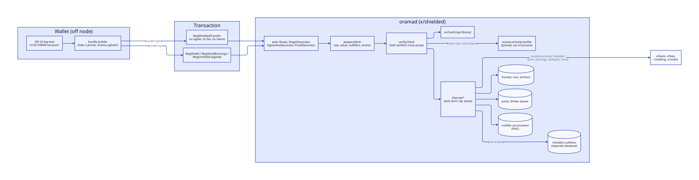
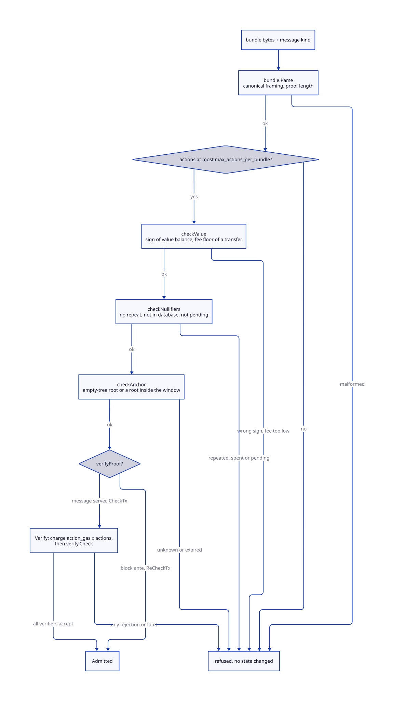
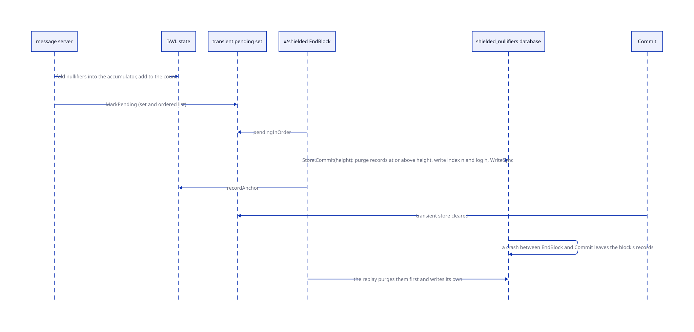
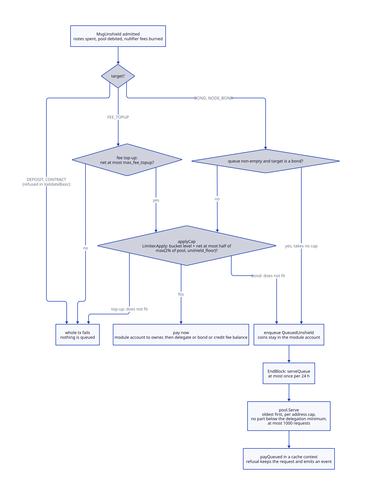

# The shielded pool

> **At a glance.**
>
> - **What:** `x/shielded` is the chain's private payment layer: a single pool of norama held in the module account `shielded`, spent and created as Orchard-style notes (Zcash Ironwood bundles, Halo 2 proofs, no trusted setup). The chain never sees an amount, a sender or a recipient inside the pool. It sees only nullifiers, note commitments, a value balance and a proof, and it checks them. Public user-to-user norama sends are allowed, so this pool is how one person pays another privately. Value enters with `MsgShield` or `MsgShieldEarnings`, moves with the signer-less `MsgShieldedTransfer`, and leaves with `MsgUnshield` to a target the signer owns, through a 24 hour cap. A node accepts a bundle only if both of its verifiers accept it: two builds of one implementation, which protect against a fault in one build and not against a logic bug in the code they share.
> - **Key numbers:** bundle of 16 actions by default and 32 at most (53,325 and 103,823 bytes); 250,000 gas per action; nullifier fee 1,000,000 norama (0.001 ORAMA) burned per nullifier; anchor window 17,280 blocks (24 h at the chain's 5 s blocks); unshield cap per pool per 24 h is the larger of 2% of the pool and 1,000,000,000 norama (1 ORAMA); fee top-up at most 10,000,000 norama (0.01 ORAMA) per transaction; queue payment per address per window 100,000,000,000 norama (100 ORAMA); 64 signer-less transfers per block; 1000 queue payments and at most 10,000 queue rows examined per window; 10 queued unshields per owner; 256 proof verifications per node between blocks in the mempool; 4096 remembered failed bundles; sighash domains `orama-shielded-ironwood-sighash-v1` and `-bound-v1`.
> - **Code:** `chain/x/shielded/` (`keeper`, `ante`, `bundle`, `pool`, `policy`, `nullifier`, `snapshot`, `verify`, `orchardffi`, `orchardverifier-bin`, `wallet`), wiring in `chain/app/shielded.go` and `chain/app/shielded_verifiers.go`.
> - **Depends on:** [global nodes](37-global-nodes.md) for the machines that run `oramad`, [chain architecture](39-chain-architecture.md) for the module set and the ante chain, [economics](40-economics.md) for base fee, earnings and the burn, [governance and contracts](44-governance-and-contracts.md) for the contract rules the pool shares.



## Why it exists

Orama has a public chain, and a public chain leaks who pays whom. The network's own money, norama, would turn every purchase of storage, every bond and every tip into a public graph. Two rules follow, and both are in the code.

First, norama may move between users in the open, and a user who wants privacy uses the pool. A bank send of norama between plain accounts is a public payment; the chain keeps no send restriction on norama, only the blocked module accounts (`BlockedAddresses`), so the pool's account `shielded` cannot be paid except through its own messages.

Second, the private way to pay a person is the pool, and using it is optional. A payment inside the pool reveals nothing but its fee. The design takes its constraints from what a chain can and cannot do cheaply:

- **Nodes verify and never prove.** Halo 2 proofs take seconds to build and milliseconds to check. The prover lives in a wallet crate that is never linked into `oramad` (`chain/x/shielded/wallet/`).
- **The set of spent notes grows forever.** One 32-byte nullifier per spend can never be pruned, because a nullifier proves nothing about age. The set has to live somewhere that scales better than the IAVL tree that the app hash walks.
- **A soundness bug in the circuit would be a counterfeiting bug.** The pool therefore carries a turnstile (the pool can never pay out more than went in), a rate cap on outflow (a counterfeiter can drain at most 2% of the pool a day), and two verifier builds (not two implementations; see below).
- **There is no one to call.** The module has no authority address, no pause, no parameter-change message and no way to switch the pool off (`chain/x/shielded/keeper/keeper.go`, package comment). Parameters are genesis values.

## The model

**Note.** A unit of shielded value, owned by a key. Only its commitment (32 bytes) and its encrypted ciphertext are public.

**Action.** One spend and one output paired inside a bundle. A bundle of n actions reveals n nullifiers and n new commitments. A bundle that spends fewer real notes than actions pads with fake spends, which is why the empty-tree root is a valid anchor.

**Bundle.** The Orchard bundle of a Zcash v6 transaction (Ironwood): `CompactSize(n)`, then n actions of 672 bytes each (`cv`, `nf`, `rk`, `cmx`, `epk` at 32 bytes, 580 bytes of encrypted note, 80 bytes of out ciphertext), then flags (1), value balance (8, little-endian signed), anchor (32), the proof (2720 + 2272 per action bytes), n spend-authorization signatures and one binding signature at 64 bytes (`chain/x/shielded/bundle/bundle.go:Parse`). The chain reads four things from it: nullifiers, commitments, value balance and anchor.

**Value balance.** The bundle's net flow between the pool and the transparent side, in norama. Negative shields (value enters the pool), positive takes value out. For a transfer it is the fee.

**Nullifier.** A 32-byte tag that a spend reveals. A second appearance of the same nullifier is a double spend.

**Anchor.** The root of the note-commitment tree that the spender proves membership against. The tree is the depth-32 Sinsemilla tree of Orchard.

**Pool.** The balance of one vintage of one asset. Vintage 1 is the only circuit (orchard 0.15.5, post-NU6.3), the asset is norama (`pool.NativeAsset`), and no message can name another. The pool balance is the turnstile: it is debited on every outflow and a debit over the balance fails the transaction.

**Signer-less transfer.** `MsgShieldedTransfer`. It names the fixed protocol address `authtypes.NewModuleAddress("shielded")` as its signer, because Cosmos requires every message to name one (`chain/x/shielded/types/keys.go:SignerlessAddress`). The tx carries no signature, no fee, no memo and no fee payer.

**Two verifiers.** The cgo library `orchard` and the out-of-process binary `orchard-process` (`orama-orchard-verifier`). They are two builds and two processes of one implementation: both link upstream `orchard` 0.15.5 and their Rust wrappers (framing, the order of checks, the pool and branch id) are near copies. `verify.Check` needs `verify.MinVerifiers` (2) with distinct IDs, and all must accept.

**Bucket and queue.** The unshield cap is a leaky bucket per pool: it holds half a cap and drains half a cap per 24 hours, so no 24 hours see more than one cap leave. An unshield to a bond that does not fit, or that arrives behind a non-empty queue, waits in the queue; the end blocker pays the queue at most once per 24 hours.

## How it works

### The four messages

| Message | Signed by | Value balance | What moves |
|---|---|---|---|
| `MsgShieldedTransfer` | nobody | positive: the fee | the fee leaves the pool; the base part and nullifier fees burn, the rest is a tip to the proposer's earnings |
| `MsgShield` | the signer | negative: minus the amount | the signer's bank balance pays amount plus nullifier fees; the pool gains the amount |
| `MsgShieldEarnings` | the signer | negative | the signer's own earnings in `x/fees` pay amount plus nullifier fees |
| `MsgUnshield` | the signer | positive: the amount | the pool is debited the amount; the target gets amount minus nullifier fees |

Every shielded message must be alone in its transaction (`chain/x/shielded/ante/ante.go:ShapeDecorator`). `ValidateBasic` of each message bounds the bundle field (1 byte to 1 MiB) and checks the signer; a transfer's signer must equal the protocol address (`chain/x/shielded/types/msgs.go`). Nothing here creates notes from nothing: every credit to the pool is paid by a transparent source in the same transaction, and every note creation inside a bundle is balanced by the proof against the bundle's value balance.

### Admission



`Keeper.Admit` runs the checks cheapest first and changes no state (`chain/x/shielded/keeper/admit.go:Admit`):

1. **Parse.** `bundle.Parse` refuses any framing the verifiers would refuse: action count zero or above `MaxBytes / ActionLen`, a proof length that is not `2720 + 2272 x actions`, a short body or trailing bytes. The Rust verifiers apply the same rule, so the two sides agree on what the bundle contains.
2. **Action limit.** More than `max_actions_per_bundle` (16) is refused before any proof work.
3. **Value rules** (`checkValue`). A transfer's value balance must be non-negative and at least `base_fee x action_gas x actions + nullifier_fee x actions`; a shield's must be negative; an unshield's positive and greater than the nullifier fees.
4. **Nullifiers** (`checkNullifiers`). No repeat inside the bundle, none in the nullifier database below the reader's height, none in the pending set.
5. **Anchor** (`checkAnchor`). The empty tree's root, or a root recorded within `anchor_window_blocks` of the current height.
6. **Proofs**, only when asked (`verifyProof`).

Where the checks run depends on the path:

- **Signed messages** (`MsgShield`, `MsgShieldEarnings`, `MsgUnshield`) go through the normal ante chain. `ShapeDecorator` runs early, before any fee is taken. `ProofDecorator` runs after signature verification, so unsigned garbage never costs proof work. In `CheckTx` it runs the full `Admit` with proofs and marks the nullifiers pending; in `ReCheckTx` it repeats the cheap checks and marks pending again without re-verifying; in a block and in simulation it does nothing. In a block the message server verifies, once (`chain/x/shielded/ante/ante.go:ProofDecorator`).
- **Signer-less transfers** are routed to their own short chain (`ante.Route`): extension options, timeout height and `SignerlessDecorator`. The decorator refuses any signature, any fee, any fee granter, any memo, more than `MaxSignerlessOverhead` (512) bytes of transaction around the bundle, and any gas limit other than exactly `action_gas x actions`. The fee is the bundle's value balance, so nothing else may pay or identify anyone.
- **The message server is the authority.** Every message re-runs `Admit` with proofs in `DeliverTx`, whatever the ante handler did (`chain/x/shielded/keeper/msg_server.go`).

The `binding` argument to `Admit` is nil except for an unshield, where it is the message's signer and target (below).

### The two verifiers

`verify.Check` fails closed. It needs at least two verifiers, none nil, with distinct non-empty IDs, and it runs none of them unless the whole set is valid; then every verifier must accept (`chain/x/shielded/verify/verify.go:Check`). Rejection reasons all wrap `ErrTampered` (malformed, non-canonical proof length, proof rejected, signature rejected, and `ErrVerifierPanic`: a panic a verifier caught on this bundle, which the same bytes cause on every node, so it is a verdict). A fault wraps `ErrVerifierFault`: the process died, hung past its watchdog, answered out of protocol or would not start. A fault says nothing about the bundle. The distinction matters twice. In the mempool a verdict is remembered and a fault is not. In a block a verdict becomes the transaction's result and a fault never does (see Failure modes).

**What two builds of one implementation protect against, and what they do not.** They protect against a memory-corruption bug, a link or ABI problem, a hang, a build mistake or a bad dependency bump in one build: that build faults or disagrees, and the bundle is not accepted on its word alone. They do not protect against a logic bug in upstream `orchard` or in the wrapper both builds carry, because a bundle that exploits it passes both. The loss from such a bug is bounded by the turnstile and the outflow cap, not prevented. The differential tests feed the same corpus of valid, tampered, truncated and oversize bundles to both and require the same class of answer (`chain/x/shielded/verify/orchardproc/differential_test.go`); they find a build difference, never a shared logic bug. A second implementation written by other people against the Zcash specification is the only thing that would give independence; none exists in Go or Rust today (Known gaps).

**The library.** `orama_orchard_verify`, a C ABI over upstream `orchard` 0.15.5 with feature `circuit`, linked through cgo under the build tag `orchardffi` (`chain/x/shielded/orchardffi/src/lib.rs`, `chain/x/shielded/verify/orchard/orchard_cgo.go`). It builds only the `PostNu6_3` verifying key; the insecure pre-NU6.2 circuit is never built. It checks the framing, every spend-authorization signature and the binding signature over the sighash it is handed, and the Halo 2 proof. A panic is caught at the boundary and returned as a code, never unwound across cgo. The verifying key takes seconds to build, so `Warm` builds it at app construction, not in a consensus handler.

**The binary.** `orama-orchard-verifier`, its own crate with its own `Cargo.lock` (`chain/x/shielded/orchardverifier-bin/`); it shares no file with the library crate but is a near copy of its wrapper and calls the same upstream crate. The node runs it as a child process and speaks length-prefixed frames over stdin and stdout: request `u64 id || sighash(32) || bundle`, response `u64 id || code(1)`, a ready frame with id `2^64 - 1` once the key is built (`chain/x/shielded/verify/orchardproc/orchardproc.go`). Requests are serialised. A request that exceeds 30 s (`DefaultRequestTimeout`), a process that dies or one that answers out of protocol kills the process and fails that request with `ErrVerifierFault`; the next request starts a fresh process. Start-up is bounded at 60 s. A fault is never turned into an accept and a request is never retried. The 30 s is a watchdog, not part of the rule: it can only turn a hung child into a fault, and in a block a fault stops the node instead of deciding the transaction, so no timer ever decides a bundle. A caught panic in the child (result code 5) is a verdict, `ErrVerifierPanic`.

**The pin.** The node refuses to start a binary whose SHA-256 differs from its pin, and refuses to start one at all without a pin. The pin is the value linked into `oramad` at build time (`chain/app/shielded_verifiers.go:ShieldedVerifierSHA256`) and nothing else: there is no flag, config key or environment variable for it, because a pin an operator could choose would let two nodes run different verifiers. Changing the pinned binary is changing `oramad`, which is a chain upgrade. The binary is opened once, hashed from that open file, and the child is started from the same open file (on Linux `/proc/self/fd/N`, the way `fexecve` works), so replacing the path or repointing a symlink after the hash starts nothing else (`orchardproc.go:openPinned`). The path is `--shielded-verifier`, else `<home>/bin/orama-orchard-verifier`; the global chain unit passes `--shielded-verifier <home>/cosmovisor/current/bin/orama-orchard-verifier`, where the installer staged the release's copy beside `oramad`. Two nodes with different binaries could disagree about a bundle, so the pin is what makes the second verifier part of consensus.

**The sighash.** Neither verifier invents the message the signatures cover; Go computes it and both are handed it (`chain/x/shielded/verify/orchard/sighash.go:Sighash`):

```text
SHA-256( "orama-shielded-ironwood-sighash-v1" || u16be(len(chainID)) || chainID || effectingData )
SHA-256( "orama-shielded-ironwood-sighash-bound-v1" || u16be(len(chainID)) || chainID
         || u32be(len(binding)) || binding || effectingData )
```

`effectingData` is the bundle prefix before the proof: the action count, every action, flags, value balance and anchor. The chain id stops a bundle signed for one Orama network from replaying on another; a verifier built for an empty chain id is refused. The wallet computes the same bytes (`chain/x/shielded/wallet/src/sighash.rs`), and tests recompute the hash from committed bundle bytes.

**Without the Rust library.** A build without cgo or without the `orchardffi` tag links `orchard_stub.go` and `tree_stub.go`: the verifier refuses every bundle with `ErrVerifierNotLinked` and the tree cannot compute the empty root, so a bundle is refused at the anchor gate. Such a node can still run the chain and every other module. It cannot admit a shielded bundle, and since a bundle is only valid if every validator verifies it, the network's validators must all run the full build.

### The unshield binding

A bundle in the mempool is public. An unshield pays value to a transparent target, so anyone who saw the bundle could submit it as their own unshield and take what it pays. The signatures therefore commit to the destination. `MsgUnshield.Binding` builds, from the decoded address bytes:

```text
u8(len(signer)) || signer || u8(target) || u8(len(validator)) || validator
    || u16be(len(node_id)) || node_id || u8(role)
```

and the sighash with a binding uses its own domain string so that a bound and an unbound sighash can never collide (`chain/x/shielded/types/msgs.go:Binding`). A bundle built for one signer and one target fails signature verification under any other. Transfers and shields carry no binding: a copied transfer pays its own fee once, and a copied shield spends the copier's own funds.

### Execution

The value rules above are checked in `Admit`; the pool arithmetic is in `Execute*` (`chain/x/shielded/keeper/execute.go`, `chain/x/shielded/keeper/unshield.go`).

**Transfer.** `register` first. Then the pool is debited the fee; base fee and nullifier fees are burned from the module account (`ExecuteTransfer`). The remainder, the tip, is cut to what the unshield cap has left (`capTip`); the part over it is burned with the base fee and does not count against the cap, and the rest is credited to the proposer's earnings through `x/fees`. When the proposer does not resolve to an account, the whole fee is burned, so nothing sits in an account that nobody can spend from. The tip counts against the pool's 24 hour cap (`capTip`), and a tip over what the cap has left fails the transfer. The reason is in the comment: a tip becomes a proposer's spendable earnings, so an uncapped tip would let a proposer who holds counterfeit notes drain the pool through fees without meeting the cap. The burned part is exempt.

**Shield.** The signer's bank balance pays amount plus nullifier fees into the module account; the nullifier fees are burned and the pool is credited the amount, so the pool balance equals what the notes are worth. `MsgShieldEarnings` is the same, but the funds come from `DebitEarningsUpTo` and a module-to-module move out of `x/fees`; it refuses if the signer has less in earnings than it needs. Fee-only balances are not shieldable.

**Unshield.** See the cap and queue below. Every path first calls `register`.

**`register`.** The step that makes a bundle's effects permanent (`chain/x/shielded/keeper/tree.go:register`): each nullifier is folded into the running accumulator, the count is increased, the nullifiers are marked pending, and the commitments are appended to the tree. The chain never creates a note itself.

### The note-commitment tree and anchors

The chain keeps the tree's frontier only, the right edge of the tree, as opaque bytes, with the current root and the size. An empty frontier is zero bytes; otherwise `position (u64 LE) || leaf (32) || one ommer (32) per set bit of the position`, at most 1064 bytes (`chain/x/shielded/types/genesis.go:MaxFrontierLen`). Sinsemilla exists only in Rust, so appending goes through `orama_orchard_tree_append`, a stateless function over bytes (`chain/x/shielded/verify/orchard/tree_cgo.go:Append`). A leaf that is not a canonical field element, or a full tree, is refused.

A bundle can fill a subtree. A subtree is 2^16 leaves (`types.SubtreeLeaves`, the shard size of the Orchard shard tree and lightwalletd's `GetSubtreeRoots`), and once the next leaf is appended its root is folded into a higher ommer and cannot be read back from the frontier. `appendCommitments` therefore splits an append where a subtree fills: it appends up to the boundary, asks the Rust code for the subtree's root from the frontier that closes it (`orama_orchard_tree_subtree_root`, which rebuilds the depth-16 frontier from the lowest 16 ommers and reads its root), stores the root in state (`Subtrees`: the subtree's index to its root and the height of the block that filled it), emits `shielded_subtree_complete` with the subtree's `index` and `root`, and goes on. The write and the event are charged on an unmetered context, as the tree-size read of the bundle event is, so the transaction that fills a subtree needs no more gas than one estimated just before it. The roots are state, so the app hash commits to them, genesis exports and imports them (`subtree_roots`, which `GenesisState.Validate` holds to exactly `floor(tree_size / 65536)` roots in index order with no gap), and the shielded invariants include that the root of the last filled subtree is stored and none beyond it (`subtree_roots_match`, also part of the conservation pass). The event stays for the indexer ([archive and indexer](42-archive-and-indexer.md)). The `SubtreeRoots` query pages the stored roots (`start_index`, `limit` default 100 and at most 1,000, answering `total = floor(tree_size / 65536)`), so any node answers for every subtree from the first. `TreeFrontier` returns the stored frontier with its height, size and root, and a test fixes that its root is `TreeState`'s (`chain/x/shielded/keeper/subtree_test.go`, and the real-chain wallet scenario reads the frontier back to the chain's root). The Rust test `subtree_roots_recombine_to_the_anchor` appends two full subtrees, takes each root as the frontier closes it, hashes them up through levels 16 to 31 with the empty roots and gets the tree's root (`chain/x/shielded/orchardffi/tests/tree.rs`); its twin `golden_subtree_roots_are_the_trees_and_recombine_to_its_anchor` fixes the two roots and the anchor of the tree of leaves 1 to 2 * 2^16 in `testdata/subtree-roots.txt`, and `TestShieldedSubtrees_chainAndIndexAgreeAndRecombineToTheAnchor` (`chain/indexer/shielded_chain_cgo_test.go`) builds that tree through the chain with bundles of 29 to 32 actions, so both boundaries fall inside a bundle, and finds the same roots in the chain's state, in its query and in the index, and the same anchor as the chain's root.

**Where a bundle's leaves are.** Every accepted bundle emits `shielded_bundle` with `kind`, `actions`, `amount`, and the tree size before its append (`tree_size_before`) and the number of commitments it appended (`commitments`, one per action). The message server reads the size after the append and takes the commitments off it, on an unmetered context so the read costs no gas, and refuses to emit when the tree holds fewer commitments than the bundle appended. The bundle's commitments took the leaves `tree_size_before` to `tree_size_before + commitments - 1`; a wallet's index needs nothing else (`TestBundleEvent_carriesTheTreeSizeBeforeAndTheCommitmentCount`).

At the end of every block `recordAnchor` stores the current root under the block height and deletes the anchor that fell out of the window (`chain/x/shielded/keeper/abci.go:recordAnchor`). An idle tree's root is recorded again every block, so it never expires. An anchor produced by a block is usable from the next block. The empty tree's root is always valid and only fake spends can use it.

### Nullifiers outside IAVL



The nullifier set lives in a dedicated database, `<home>/data/shielded_nullifiers`, in the same backend as `application.db` (`chain/app/shielded.go:openNullifierStore`). It has two key spaces (`chain/x/shielded/nullifier/store.go:Store`):

- `n || nullifier -> height (u64 BE)`, the index;
- `h || height (u64 BE) || seq (u32 BE) -> nullifier`, the append-only log in insertion order.

The app hash cannot cover a set that large cheaply, so it commits to a running accumulator in IAVL: `acc = SHA-256(acc || nullifier)` folded over every nullifier in insertion order from 32 zero bytes, plus a count (`nullifier.Fold`). Two honest nodes agree on the set if they agree on the accumulator.

A record written at height h is visible to a reader at height `asOf` when h is below `asOf`. A block reads at its own height, so it never sees the records that it, or a block that it replaces, wrote; the mempool's check state reads at the last committed height plus one (`chain/x/shielded/keeper/pending.go:asOf`). That rule is what makes crashes and rollbacks safe:

- **Writing.** A message folds its nullifiers into the accumulator, marks them in the transient store (`transient_shielded`, a set and an ordered list), and a failed transaction rolls both back. The end blocker reads the pending list in order and calls `Store.Commit(height, nullifiers)` before `Commit`.
- **Crash between FinalizeBlock and Commit.** The database holds the block's records and IAVL does not. On restart the block is executed again; its end blocker first deletes every record at or above its height, then writes its own. The replay produces the same app hash.
- **Rollback.** Records above the rollback height are invisible and are deleted when the first block at that height commits.
- **Duplicates.** `Commit` refuses a nullifier already recorded below its height, and a duplicate within the block, as corruption.
- **Genesis.** Export lists the first `nullifier_count` records in order (later records belong to a block that never committed) and refuses if database and state disagree. Import requires an empty database, writes at height 0 so every height sees them, and `GenesisState.Validate` refuses a list that does not fold to `nullifier_accumulator`. The genesis is as large as the set.
- **State sync.** The IAVL snapshot carries the accumulator and the count only. `snapshot.Extension` (`shielded_nullifiers`, format 1) streams the first `count` records in payloads of 4096 records, and a restore imports them into an empty store and fails unless they fold to the accumulator that the restored state committed to. The fold covers the nullifiers and their order, not the height written beside each, so the restore also refuses a height that is negative, that goes down, or that is above the snapshot height: a negative one would be stored under a key that sorts after every real height and the node would later serve the records in another order. A failed restore resets the store (`chain/x/shielded/snapshot/snapshot.go`, `chain/x/shielded/snapshot/snapshot_test.go:TestRestore_refusesARecordAtANegativeHeight`).
- **At start.** For a node past height 0, `checkShieldedStoreAtStart` folds the database and panics if it disagrees with the committed accumulator and count: a database missing after a restore, from another chain or cut short would accept a spent nullifier or refuse a fresh one and the node would diverge on the first shielded bundle (`chain/app/shielded.go`).

### Block proposals

A proposal is checked before it is voted for (`chain/app/proposal_proofs.go`). First the work is bounded from the proposal alone, with limits every validator reads from the same state (`keeper.ProposalChecker`): every shielded bundle (signed messages and signer-less transfers) must parse, stay within `max_actions_per_bundle`, and the actions of the whole proposal must fit the block's `max_gas` at `action_gas` each; no bundle and no nullifier may appear twice. A breach is a deterministic refusal, identical on every honest validator. Only then is each bundle put to the mempool's verifiers, under one wall-clock budget for the whole proposal (`proposalProofBudget`, 2.5 s, under CometBFT's default `timeout_propose` of 3 s). A bundle this node's mempool already verified valid is not verified again (a bounded memory of valid verdicts, 4096 hashes, never read by a block). The proposal is refused, with a nil vote, on a rejection, on a fault, on a verifier that is still starting or busy, and when the budget runs out; an overrun and a fault are local to the validator and a rejection is not. Nothing in this path ever halts the node.

Proposal checks have a child process of their own, apart from the mempool's (CheckTx, ReCheck and gRPC simulations share that one and never touch the proposal child), so a flood of mempool work cannot make a proposal wait or fail. Each set is, in order, a killable child process and then the in-process library. A bundle that makes the child fault or hang is stopped there, but only in the part of the block the proposal check looks at. **A bundle in the inclusion-list forced prefix is not pre-checked at all (below), so a bundle that crashes or hangs a verifier, the child or the in-process library, still reaches `FinalizeBlock` when one validator lists it, and there it stops every node.** **A bundle that aborts or hangs the in-process library has nothing in front of it: it is not caught by the proposal check, and it still stops every validator in `FinalizeBlock`.** The out-of-process check protects against the child's failures only.

`PrepareProposal` leaves out the transactions that fail the same check, after the signer-less cap, so an honest proposer whose verifier is ready does not build a block its peers refuse for this reason; while its verifier is starting it builds blocks without shielded transactions, or its block is refused. **The check applies only to the proposer's own part of the block, never to the transactions an inclusion list forces to its front.** The inclusion rules require a transaction that any validator listed and that passed the ante chain, whatever its proof, so one validator is enough to put a signed shielded transaction with a bad proof, or one that spends a nullifier another listed transaction spends, into the forced prefix. A proposal check that refused such a prefix would let that one validator stall every round, so the prefix goes to execution as it is, where `FinalizeBlock` verifies it, fails the transaction with an ordinary result and halts nobody (a verifier fault there still halts, as for any bundle). `FinalizeBlock` still verifies every bundle with the block's own verifiers and still halts on a fault: the proposal check is a gate in front of it, not a replacement. Every honest block is verified twice. The proposal child has the mempool child's 3 s request timeout, busy wait and background start, but the proposal is answered within what is left of its budget: with less than 250 ms left (`MinProposalRequest`) a bundle is not put to the process at all, and a request still running when the budget ends is answered "busy" and left to finish, so the healthy process is never killed, and made to build its verifying key again, for being asked too late; only exceeding the process's own 3 s request timeout is a fault that stops it. So `ProcessProposal` does not run past its budget by more than a few milliseconds, except for the in-process library, which has no deadline; a busy or starting process or an exhausted budget ends the checking at once with a nil vote; a validator that has just restarted votes nil on shielded blocks until that process is ready. A node that has no verifiers to check with (a localnet or a scripted devnet, which run without them on every node and refuse every bundle at execution) skips the proposal check.

### The mempool defence

A signer-less transfer pays nothing before its proof is checked. Without a bound, a stream of bundles that fail only the Halo 2 proof costs every node one verification each. Two node-local, `CheckTx`-only mechanisms limit that (`chain/x/shielded/keeper/admission.go`):

- a bounded memory of failed bundles (`MaxFailedBundles`, 4096, keyed by the SHA-256 of the exact bundle and binding bytes, oldest evicted first), so each distinct failing bundle costs one verification per node; only verdicts (`ErrTampered`) are remembered, never faults;
- a budget of `MaxCheckVerificationsPerBlock` (256) verifications between two blocks, reset in `EndBlock`. When it is spent, the answer is `ErrMempoolBusy`: the transaction is not invalid and can be sent again.

Neither runs inside a block, and neither affects state: a block verifies every bundle, always. Inside a block, `max_signerless_per_block` (64) bounds the proof work that signer-less transfers put in one block. The count lives in the transient store, so a failed transfer returns its slot and the next block starts at zero (`chain/x/shielded/keeper/signerless.go:takeSignerlessSlot`). That check runs while the block executes, after every transfer in it has been admitted, and the app has no mempool, so the SDK's `ProcessProposal` would accept any block. The proposal handlers therefore enforce the limit up front (`chain/app/signerless_budget.go`): `PrepareProposal` leaves the surplus signer-less transfers out of the block it builds, and `ProcessProposal` rejects a block holding more than `max_signerless_per_block` of them, counting the transactions an inclusion list forces as well as the proposer's own. A signer-less transfer is unsigned, so it has no sender and no sequence for an inclusion list to name, and a list cannot force one into a block; the forced prefix never holds any, and an honest proposer never builds a block it would refuse. The limit is read from state, so every validator judges a proposal against the same number.

### The cap and the queue



The cap bounds what a counterfeiter can take out, whether through unshields or through tips. For a pool with balance B, the cap is `max(2% of B, unshield_floor)`, with B read before the outflow (`chain/x/shielded/pool/pool.go:CapAmount`), and the bucket level, the net outflow not yet drained, may not exceed `Capacity(cap)`, half of it rounded down (`Limiter.Apply`). The fraction is a constant of the code (`UnshieldNumerator`, `UnshieldDenominator`), not a parameter. The level drains by `Capacity(cap)` per 24 hours of block time, rounded down, in whole norama and exact integer arithmetic (`Limiter.Roll`): the limiter keeps the level and the instant the drain has been accounted up to, and moves that instant forward only by the time the drained norama stand for, rounded up, so blocks too short to drain a whole norama are not lost. There is no moment at which the counter resets, so two caps cannot leave the pool on either side of a boundary. What the bound is: a burst of at most half a cap, and after it at most half a cap per 24 hours, so an interval of length T up to 24 hours admits at most `cap/2 + (cap/2) * T/24h`, which is at most one cap. At most one cap leaves the pool in any 24 hours, and the sustained rate is half a cap per day. `TestLimiter_noSlidingWindowOfAWindowAdmitsMoreThanOneCap` checks the sum over every sliding 24 hour interval of random outflow sequences. The cap is re-read from the pool at each outflow, so the bound holds for the cap in force at the time, and a pool that shrinks lowers it. Fee burns are exempt; anything that becomes spendable counts.

`MsgUnshield` has a target, and the signer must own it. There is no beneficiary field, and a plain user bank account is never a target:

| Target | Behaviour |
|---|---|
| `BOND` | the signer's own delegation to `validator`, through `x/staking`'s own message server; held to `x/power`'s `min_delegation_for_rewards`, which the shielded path would otherwise skip because it is not a signed `MsgDelegate` (`chain/app/shielded.go:shieldedBonder`). Queues when it does not fit. |
| `NODE_BOND` | the signer's own role bond on `node_id` (`MsgBondNode` with the signer as operator, so `x/nodes` refuses a node the signer does not own). `x/nodes` is asked at once (`NodeBonder.CheckBondNode`, the checks of `BondNode` without moving a coin): an unknown node, someone else's, a closed node or a role it lacks is refused with `ErrTarget` whether the request would be paid or queued. Queues when it does not fit. |
| `FEE_TOPUP` | credits the signer's fee-only balance in `x/fees`, which pays base fees and cannot be bonded, sent, shielded or deposited. At most `max_fee_topup` per transaction. Counts against the cap and fails the whole transaction when it does not fit. |
| `DEPOSIT`, `CONTRACT` | refused in `ValidateBasic`, before any proof work: no path exists. |

The flow of `ExecuteUnshield`: reject the unlinked targets; refuse a top-up over `max_fee_topup`; for a bond, check the delegation minimum now; for a node bond, check the bond with `x/nodes` now; `register`; debit the pool the full amount (the turnstile) and burn the nullifier fees; then either pay, or queue. A request whose notes are spent has left the pool even if it is queued: its coins stay in the module account, so the module balance equals the pools plus the queue.

A bond that arrives while the queue is non-empty waits its turn and takes no cap. A top-up never waits.

The queue is held bounded at the door. A request that would be refused at payment for a reason known when it is made is not queued (the delegation minimum and the node-bond check above). One owner may have at most `MaxQueuedPerOwner` (10) requests queued; the eleventh fails the unshield with `ErrQueueOwnerFull`, before any note is spent. The count is kept in `QueueOwners`, up on enqueue and down when a request is paid in full or refunded, rebuilt from the queue at genesis, and checked against the queue by the ledger invariants (`QueueIndexMatches`).

`serveQueue` runs in the end blocker at most once per 24 hours (the limiter records the time of the last service in `served_window_start`). Capacity is what the bucket leaves of its half-cap capacity once drained, `Limiter.Remaining(CapAmount(balance, floor))`. It is handed out by `pool.Serve`, oldest request first: each request gets the least of what it asked, what the capacity has left and what its address's `queue_per_address_cap` has left across all that address's requests. A request is therefore never starved by a larger one behind it, and one address cannot take more than its cap however many requests it queued. Capacity left after the per-address cap goes to the next request in line. A request that would be paid only in part is skipped when the target would refuse that part: a bond is not paid in a grant that leaves the delegator's stake with the validator between zero and `min_delegation_for_rewards` (`Bonder.CheckMinimum`, the same rule as at enqueue), and the capacity stays for the next request; a request that fits whole is always attempted, so a refusal by its target is reported. The part-payment minimum of a node bond is checked by `x/nodes` only when the bond is made. The window reads at most `MaxScannedPerWindow` (10,000) rows, oldest first, and stops after `MaxServedPerWindow` (1000) payments went out or when the capacity is used up, so the end blocker's work does not grow with the queue. A refused payment is not a payment: it does not count towards the 1000, so a run of requests that will be refused cannot hold back the honest ones behind it for more than the window in which they are read; the 10,000-row bound is what keeps a window bounded however many refuse. Each payment runs in a cache context; if the target refuses (a validator that no longer exists, a retired node, a delegation that would be dust) the cache is dropped, the request stays queued with its `refusals` count raised and the block emits `shielded_queue_payment_failed` with its id, owner and reason. A refused payment does not use the window's capacity or its address's cap (`pool.Serve` takes them only after the payment went out), so a request that can never be paid cannot starve the ones behind it. A request refused `MaxQueueRefusals` (3) windows in a row is given up on: what is left of it goes from the module account back to its signer's bank balance, it leaves the queue and the block emits `shielded_queue_refunded` (a refund the bank itself refuses leaves it queued for the next window). The count is of refusals with no payment in between and no skip in between: a payment that goes out resets it, and so does a window that reads the request and skips it without a refusal (the capacity is gone, its address's cap is used up, or the part it could get is below the delegation minimum). Genesis refuses a queued request whose count has reached `MaxQueueRefusals`, since such a request is refunded and no longer queued. The other requests are still paid.

### Addresses and scanning

**The text form.** A shielded address is the 43 raw bytes in Bech32m (BIP-350) with the human-readable part `oramas`: 82 characters, lowercase, `oramas1` and 75 data characters (344 bits and a zero padding bit, then 6 of checksum). A decoder accepts all capitals and refuses mixed case. It checks, in this order: case, the `1` separator, the prefix, the alphabet, the data length, the Bech32m checksum (the original Bech32 checksum fails it) and the padding bit, and reports `mixed_case`, `no_separator`, `wrong_prefix`, `bad_character`, `wrong_length`, `bad_checksum` or `bad_padding`. It is structural: it accepts any 43 bytes, and the Rust wallet's `decode_orchard` also checks that they are an address Orchard can pay. There is one codec per language, Rust in the wallet crate (`chain/x/shielded/wallet/src/address.rs`), Go for the CLI (`core/pkg/shieldedaddr`) and TypeScript for the SDK (`sdk/src/chain/shielded-address.ts`), and all three read `chain/x/shielded/wallet/testdata/addresses/addresses.json`: valid addresses taken from the key-tree vectors, the all-capitals forms, and sixteen strings each broken one way with the reason expected. A Python script written against the BIP-350 reference code, independent of the three, generates the file (`testdata/addresses/generate.py`). `orama chain send` takes a shielded address for a private send and refuses an `orama1...` account or a mistyped address before anything else, and `--public` refuses a shielded address.

**What a wallet reads.** The indexer serves the actions of every accepted bundle in the compact form of ZIP-307, in order, with each action's leaf position and the tree size after each block, and the roots of the filled subtrees (`/index/v1/shielded/actions` and `/shielded/subtree-roots`, [archive and indexer](42-archive-and-indexer.md#the-indexer)); the chain serves the same roots from its state (`SubtreeRoots`), complete from the first subtree whatever the node's index began at. With `TreeFrontier` that is enough to find notes by trial decryption, to keep witnesses without every leaf and to carry the tree on from a recent block. All of them are public: they hold only what every node holds.

**Sizes.** A canonical bundle of `n` actions is `compactSize(n) + 820n + 41 + compactSize(proof) + (2720 + 2272n) + 64(n + 1)` bytes, so one of the default 16 actions is 1 + 13,120 + 41 + 3 + 39,072 + 1,088 = **53,325 bytes**. `bundle.MaxActions` (32) is the protocol ceiling on `max_actions_per_bundle` (`Params.Validate` refuses more), and `bundle.MaxBytes` is exactly `bundle.Len(32)`, **103,823 bytes**: it is derived, not chosen, and a test fixes `MaxBytes == Len(MaxActions)`, that a bundle of the ceiling parses and that one more action does not fit. The caps outside the chain follow from it: the onion transaction gate (`core/pkg/txgate`) takes a request of at most the base64 of a transaction of 103,823 bytes and 4 KiB of envelope, plus 1 KiB of JSON, 144,916 bytes, where it took 512 KiB; the gateway's 1 MiB is CometBFT's mempool limit for every kind of transaction and stays. The out-of-process verifier's frame limit (1 MiB and 40 bytes) is looser than the Go limit that gates it first. Because the onion transaction gate takes only that much, onion broadcast carries shielded-size transactions and no more: a larger transaction, such as a `MsgStoreCode` with a real contract, is refused by the gate (`MaxBody`) and has to be broadcast through a gateway.

### Wallet side

The prover is a separate crate, `orama-shielded-wallet`, built against the same exact pins as the verifier crate so that the wallet builds what the node verifies. Keys follow ZIP-32 hardened-only derivation with an Orama personalisation: BIP-39 seed, HKDF-SHA256 with salt `orama-shielded-v1`, a master key from BLAKE2b-512 keyed `OramaIP32Orchard`, then the path `m/32'/0x4F52414D'/account'`. No Orama key equals a Zcash Orchard key derived from the same seed, and the tree is disjoint from every other branch of the seed (`chain/x/shielded/wallet/src/keys.rs`). The builder produces spends with Merkle witnesses, outputs, the proof and the signatures over the Orama sighash (`chain/x/shielded/wallet/src/bundle.rs`). A signer-less transfer's gas is computed as `action_gas x actions`; simulation cannot give it, because the ante handler does not verify in simulation. The builder has two entry points: `build_bundle` takes a whole in-memory `NoteTree`, and `build_bundle_with_paths` takes an anchor and, for every spend, the note with its Merkle path, so a wallet that keeps only a sparse tree (a shardtree) can spend; `build_bundle` is a thin wrapper that supplies `tree.root()` and `tree.witness(position)`. The path-taking builder checks that each path leads from the note's commitment, at the spend's position, to the anchor, and refuses a stale or foreign path before it proves anything (`BundleError::BadPath`). The wallet's note storage form (address, value, rho, rseed, version; hex) lives in `chain/x/shielded/wallet/src/notes.rs` with a golden-bytes test. The crate builds for `wasm32-unknown-unknown` with `--no-default-features`: its `multicore` feature (on by default) turns on parallel proving through orchard, and without it halo2 runs single-threaded, which a browser needs; on that target `getrandom` is routed to the browser's `crypto.getRandomValues`, and building it needs a clang that targets wasm32 (the C code in `secp256k1-sys`).

Two details of the derivation: the coin type `0x4F52414D` is the ASCII "ORAM" (1329811789), not a SLIP-44 registration and unrelated to the Cosmos coin type; and an address is the raw 43-byte Orchard address (an 11-byte diversifier and the 32-byte `pk_d`). RootWallet must carry the `orama-shielded-v1` branch for a seed to reach the same keys.

**Vectors.** `chain/x/shielded/wallet/testdata/keys/keys.json` holds the all-"abandon ... about" seed and two other BIP-39 phrases, with, for accounts 0 and 1, the chain code, spending key, full viewing key, external and internal incoming viewing keys, outgoing viewing key and the first three external addresses; `cargo test` recomputes them and checks the framework against orchard's own `SpendingKey::from_zip32_seed` under Zcash's personalisation. `cargo run --release --example gen_scenario` writes `testdata/bundles/scenario.json`: real v6 bundles from an in-memory note tree (two shields, a transfer that spends a real note and leaves the fee of 100 in its value balance, and an unshield bound to its signer and target), each with the canonical bundle bytes, effecting data, Orama sighash, anchor, nullifiers, commitments and value balance. A seeded ChaCha20 RNG makes a regeneration byte-identical (about 20 s of proving). Every committed bundle is checked three ways: Rust passes it through `orama-orchard-ffi`; `TestSighash_matchesWalletBuilder` recomputes the sighash with `orchard.Sighash`; and under the `orchardffi` build `TestVerify_walletBuilderBundlesAccept` runs it through the library verifier, while `TestShieldedReal_theWalletBuilderScenarioRunsThroughTheChain` (`chain/app/shielded_wallet_test.go`) runs the scenario through `FinalizeBlock` with both verifiers, checking before each step that the tree root equals the wallet's anchor, that the wallet's binding equals `MsgUnshield.Binding` and that every nullifier is spent. `make orchard-test` runs all of it. Not built: the wallet scans one bundle at a time by trial decryption, its note tree recomputes roots and paths from every leaf and is for tests and vectors rather than an incremental witness store, and it has no fee and delegation logic.

## State it owns

| State | Holds | Written by | Read by | Where |
|---|---|---|---|---|
| `Params` | the eight parameters | genesis only | every check | IAVL, prefix 0 |
| `Pools` | balance per (vintage, asset) | shield, transfer, unshield | cap, invariants, queries | IAVL, prefix 1 |
| `Limiters` | drain instant (`window_start`), bucket level (`counted`), time of last queue service | unshield, tips, queue | cap, `serveQueue` | IAVL, prefix 2 |
| `Queue` | `QueuedUnshield` by id | unshield, `serveQueue` | end blocker, invariants | IAVL, prefix 3 |
| `NextQueueID` | the queue sequence | `enqueue` | `enqueue` | IAVL, prefix 4 |
| `QueueOwners` | queued requests per owner | `enqueue`, `serveQueue` | `enqueue`, invariants | IAVL, prefix 13 |
| `Frontier`, `TreeSize`, `CurrentRoot` | the tree's right edge, its size and root | `appendCommitments` | `Append`, `recordAnchor` | IAVL, prefixes 5, 6, 7 |
| `Anchors`, `AnchorHeights` | root to height, and height to root | `recordAnchor` | `checkAnchor` | IAVL, prefixes 8, 9 |
| `Accumulator`, `NullifierCount` | the fold of every nullifier, and how many | `register` | app hash, invariants, snapshot | IAVL, prefixes 10, 11 |
| `Subtrees` | the root of each filled 2^16-leaf subtree and the height that filled it | `appendCommitments` | `SubtreeRoots`, invariants, genesis | IAVL, prefix 12 |
| pending set and list, sequence, signer-less count | this block's nullifiers and signer-less transfers | `MarkPending`, `takeSignerlessSlot` | `checkUnspent`, `EndBlock` | transient store `transient_shielded` |
| nullifier database | the spent set | `EndBlock` via `Store.Commit` | `checkUnspent`, queries, snapshots | `<home>/data/shielded_nullifiers` |
| module account `shielded` | the pools plus the queue, in norama | bank | invariants | `x/bank`; permission `Burner` |
| failed-bundle memory, verification budget | rejected exact bytes; proofs left this block | `Verify` | `Verify` | memory, per node |
| verifier process | the child `orama-orchard-verifier` | first `Verify` or `Warm` | `Verify` | one child process per `oramad` |
| verifying key | the Halo 2 key | `Warm` | library | memory, built at start |

Queries, all point lookups (`chain/x/shielded/keeper/grpc_query.go`): `Params`, `Pools`, `TreeState` (size, root, number of anchors, accumulator, count), `TreeFrontier` (height, size, root and the frontier bytes), `SubtreeRoots` (a page of at most 1,000 roots by index, and `total`), `NullifierSpent` and `Invariants`. REST paths: `/orama/shielded/v1/params`, `/pools`, `/tree-state`, `/tree-frontier`, `/subtree-roots`, `/nullifier-spent`, `/invariants`. There is no query that lists the queue, the notes, or any note content, and none can exist, because the chain does not hold them.

## Lifecycle

**Genesis.** `DefaultGenesisState` is an empty pool, an empty tree and zero accumulator. `InitGenesis` validates the state, requires the nullifier database to be empty (a database left from another chain would refuse bundles the new chain has never seen) and loads pools, limiters, queue (rebuilding the per-owner count; a queue that has an owner over `MaxQueuedPerOwner` or a request at `MaxQueueRefusals` refusals is refused), tree, anchors, subtree roots and nullifiers.

**Boot.** `buildShielded` opens the nullifier database and constructs the verifiers. On a node with a chain id, it builds the library and the process verifier and warms both, so neither verifying key is built inside a consensus handler. If the library is linked, the process verifier must start too: a node that cannot verify must not serve blocks. If the binary is absent or the library not linked, a node of a stagenet, testnet or mainnet chain refuses to start: it would vote on proposals it never verified and fork itself off at the first shielded transaction it executes. Only a localnet or a scripted devnet (a localnet or devnet chain id by `params.ClassOfChainID`, `chain/app/shielded_verifiers.go:verifiersOptional`) starts, logs that it accepts no shielded bundle, and refuses every bundle with `ErrVerifierNotLinked`. An app with no chain id, the throwaway instance the CLI builds to read module metadata, gets no verifiers. After the app is built, `checkShieldedStoreAtStart` folds the nullifier database against the committed state.

**Normal operation.** Per block: transactions execute, each bundle marks its nullifiers pending and folds the accumulator; the end blocker (ordered before `x/staking`, so a bond the queue pays is seen by that block's validator set) refills the mempool budget, serves the queue if 24 hours have passed since it last did, writes the block's nullifiers and records the anchor.

**Rolling upgrade.** The module is at consensus version 1 and has no migration. A change to the tree, the sighash, the accumulator fold or the verification rules is state-breaking and has to ride a governed chain upgrade ([global nodes](37-global-nodes.md#cosmovisor-staging)). The verifier pin is linked into `oramad`, so a new verifier binary arrives with a new `oramad`; a node whose binary differs from the pin does not run it.

**Restart.** The verifier process is started again on first use. A node that stopped on a verifier fault executes the same block again from the last committed state. The mempool's failed-bundle memory and its budget are lost, which only means a node re-verifies a bundle it had already rejected.

**Node loss.** The nullifier database must be restored together with `application.db`, or rebuilt by state-syncing with the snapshot extension. A node that loses only the nullifier database refuses to start (above); the repair is to reset the node's data and sync again.

## Failure modes

| Trigger | What the system does | What you observe |
|---|---|---|
| Build without cgo or the `orchardffi` tag | a stagenet, testnet or mainnet node refuses to start; on a localnet or devnet every bundle is refused with `ErrVerifierNotLinked` and the tree cannot compute the empty root | a start panic naming the chain and `orama-orchard-verifier`; on a localnet or devnet, the start log says the node accepts no shielded bundle |
| Verifier binary missing or not at its pin | the process verifier will not start; a binary configured but unstartable stops the node; an absent one stops a stagenet, testnet or mainnet node and leaves every bundle refused on a localnet or devnet | panic naming `--shielded-verifier` and the pinned `orama-orchard-verifier`, or `ErrBinaryPin` with both hashes. A binary that disappears or changes after start is a fault of the machine: in a block the node stops (next row) |
| Verifier process hangs for 30 s, crashes or answers out of protocol, or its binary is gone or changed, or the verifiers are missing on a chain that must verify | the process is killed and the request fails with `ErrVerifierFault`; the next request starts a new process. A fault is a fact about this machine, not a verdict on the bundle, so in a block it records no transaction result: the keeper panics with a `VerifierHalt` (`chain/x/shielded/keeper/halt.go`) and the app's transaction recovery (`chain/app/shielded.go:verifierHaltHandler`) logs it with the height and the SHA-256 of the bundle in flight and ENDS THE PROCESS with exit status 87 (`app.ExitVerifierHalt`). It does not rely on the panic: CometBFT's consensus routine recovers a panic, logs `CONSENSUS FAILURE` and stops consensus but leaves the process alive, so systemd would never restart a node that no longer commits. The chain unit has `Restart=always`, `RestartSec=5` and no start limit (`core/pkg/install/global_units.go`, a test pins it), so the node restarts every five seconds, with no growing delay (systemd's `RestartSteps` needs version 254 and may never reset), and executes the same block against a working verifier, reaching the verdict its peers reached. If it keeps stopping, the operator reads the log line, which names the verifier flag, the binary and what to check (the file, memory). Not linked and not distinct verifiers count as a fault only on a chain that must verify (not a localnet or a scripted devnet, which run without verifiers on every node and refuse every bundle alike). A node that stops and restarts in a loop is a crash loop for monitoring to flag (an `orama-global-chain` unit that restarts more than a few times an hour). In the mempool and in a simulation a fault only refuses the transaction on this node, with a generic "verifier unavailable on this node" error, and a verifier process that is still starting answers `ErrVerifierStarting` before the verification budget is spent: that is neither a verdict nor a fault, and nothing is remembered for it; the detail (paths, hashes) goes to the node log only. The mempool (CheckTx, ReCheck and gRPC simulations; at most 2 simulations verify at once, the rest are refused with the one generic text) verifies on a child process of its own (`Dependencies.MempoolVerifiers`; the linked library is shared) with a request timeout of 3 s (`mempoolRequestTimeout`, not the block verifier's 30 s), so mempool work, which anyone can send, does not queue behind the block verifier's mutex and a bundle that hangs the mempool's child costs at most those 3 s plus the 250 ms a request waits for a busy process: 3.25 s, which is also the longest a CheckTx can delay the next block. That is a bound, not isolation: CometBFT's local ABCI client takes one lock for CheckTx and FinalizeBlock, so a CheckTx waiting on its child delays the next block by the same time. The mempool's child is started in the background at construction and again after any fault (building the Halo 2 key takes seconds; a node builds it four times at boot, once in-process for the library and once in each of the three child processes, the block's, the mempool's and the proposal's, the last two in the background), and until it is ready CheckTx refuses with a local fault rather than build the key under that lock. The child runs with an empty environment, and ends when the node closes or dies: its stdin closes, and the kernel also kills it (`Pdeathsig`; the child is forked from an OS thread that never exits, because the signal is tied to the forking thread). The mempool remembers the hash of a bundle whose check faulted for one minute (`keeper.FaultMemory`, at most 1024 hashes) so resending a bundle that hangs the child cannot keep it busy; that memory is not a verdict and a block never reads it. A verdict never depends on time or process health: what the verifiers say depends on the bundle's bytes alone. A panic the verifier catches on a bundle (result code 5, `ErrVerifierPanic`) is a verdict: the same bytes panic the same code on every node. The child ends after answering a panic and the node stops it, so the next request runs on a fresh process; a panic in a fresh child is the bundle's own. In the in-process library a caught panic is a verdict too, but the library lives in the node's process and cannot be restarted, so a panic that left shared state behind (a poisoned lock in the verifying key) could change a later verdict on that node; the library keeps no mutable state beyond the verifying key built once at start, and this is the one place where the determinism argument rests on the code rather than on a process boundary. The tree append in `ExecuteTransfer` also returns `ErrVerifierFault` for an unknown result code; that is a deterministic function of the same inputs on every node, and is not covered by the halt. A block proposal is checked before it is voted for (Block proposals), so a bundle that rejects or faults the verifier normally never reaches FinalizeBlock, where only a fault halts | in a block, a node that exits with status 87 and restarts; in the mempool, one refused transaction |
| Bundle that fails its proof | refused; in the mempool the exact bytes are remembered | `ErrProofRejected` or `ErrSignatureRejected`; resubmitting the same bytes is refused without a verification |
| Mempool verification budget spent | `ErrMempoolBusy` for further bundles until the next block | the transaction is not invalid; send it again |
| Double spend, in a block or against the pending set | `ErrNullifierSpent`; a transaction that fails after marking rolls the mark back | the second bundle fails; the first is unaffected |
| Anchor older than the window, or never a root | `ErrAnchorUnknown` before any proof is checked | the wallet must rebuild against a recent root |
| Transfer fee below base fee of its gas plus nullifier fees | `ErrFeeTooLow` | the wallet reads the base fee and rebuilds |
| Signer-less block full | a proposal with a 65th transfer is rejected; a proposer leaves the surplus out; at execution the 65th would fail and return its slot | `ErrSignerlessBlockFull`; retry next block |
| Unshield over the cap | a top-up fails whole; a bond is queued | `MsgUnshieldResponse.queued` true; the coins arrive in a later window |
| Queued target refuses payment | the request stays and the others are paid; after 3 refusals in a row (no payment or skip in between) it is refunded to its signer's bank balance | event `shielded_queue_payment_failed` each window, then `shielded_queue_refunded` |
| Crash between FinalizeBlock and Commit | the block replays; its nullifier records are purged then rewritten | no divergence; same app hash |
| Nullifier database missing, short or foreign at start | the node panics at start | the panic names `<home>/data/shielded_nullifiers.db` and says to reset the data and sync again |
| Disk full under the home | `WriteSync` of the nullifier batch fails in `EndBlock`, which fails the block on this node | the node halts; the other validators continue |
| Clock skew | the cap, the window and the anchor window all use block time and height | none from skew on the host |
| Accumulator disagrees with the database in a running node | `Invariants` query reports `accumulator_matches` false with the detail | the node's own record of divergence; there is no automatic halt |

## Trust and security

**What the chain learns.** It sees, for every bundle, the nullifiers, the commitments, the value balance, the anchor and the ciphertexts. For a shield, an unshield and a transfer's fee it sees an amount. An observer can count how many notes exist and how many are spent, can tell when a transfer pays an unusual fee, and can tie a shield or an unshield to the signing account. It cannot tell which note a nullifier spends, who owns a note or what is in it. A transfer has no signer, no memo and no fee payer. The tip goes to the proposer's earnings account in the clear.

**Counterfeiting.** A soundness bug in the circuit or in `orchard` would let someone mint notes. The chain cannot detect that. The defences are bounded loss and not prevention: the turnstile means the pool pays out at most what went in; the cap means at most 2% of the pool (or 1 ORAMA, whichever is larger) leaves per 24 hours across unshields and tips; the queue, served oldest first under the per-address cap, spreads what must be paid. The two verifiers defend against bugs in one build, not against a logic bug in the shared crate (see Known gaps).

**Malleability and replay.** A copied unshield fails its signatures because the binding commits to signer and target. A bundle for another chain fails because the chain id is in the sighash. A replayed bundle fails on its nullifiers. A copied transfer or shield is harmless as described above.

**Denial of service.** An attacker can submit bundles that fail their proofs. Each distinct bundle costs a node one verification, at most 256 per block between blocks, and no signer-less transfer is charged until its proof passes. This is a bound on the CPU and not on the admission queue: a busy budget turns away honest bundles too until the next block. The bundle that is turned away is not the garbage, and the garbage is free: an attacker sends 256 distinct bundles that fail only the proof, each costs a node one verification, and every honest bundle sent to that node before the next block gets `ErrMempoolBusy`. The failed-bundle memory does not help, because each garbage bundle is new. This is an accepted risk, not a defect fixed here (`chain/x/shielded/keeper/admission.go`). It affects the mempool of a node, never a block, and the sender of the honest bundle can send it again or to another node. The mitigations are outside the keeper: per-peer rate limits at the sentry nodes that face the public (the budget is per node, not per peer, so the node cannot tell the sender of garbage from anyone else), and a budget measured on production hardware rather than the placeholder 256.

**Verifier compromise.** An attacker who can write the verifier binary changes what a node accepts, and a node that differs from the network forks itself off. The pin is the defence; it is checked before every start of the child, on the file that is then started (`chain/x/shielded/verify/orchardproc/orchardproc.go:openPinned`). On Linux the bytes hashed are the file that runs: a file swapped in at the path after the hash is not executed. Left open: a writer with write permission on the binary's own inode could change its bytes between the hash and the start, and on macOS (a developer machine, never a chain node) the file is started by name. On a global node the binary and every directory above it in the cosmovisor layout are root's and not writable by the chain account; the chain account can only repoint the `current` link, and it already runs `oramad` itself, so the window gives it nothing it did not have (`core/pkg/cosmovisor/layout.go`).

**Module authority.** None. There is no governance path to the module: no parameter change, no pause. Changing a parameter or the cap requires a chain upgrade.

## Limits and scale

| Resource | Bound | Source |
|---|---|---|
| Bundle size | 53,325 bytes for the default 16 actions; 103,823 for the ceiling of 32 | `bundle.Len`, `bundle.MaxBytes`, `bundle.MaxActions`, `max_actions_per_bundle` |
| Onion gate request | 144,916 bytes | `txgate.MaxBody` |
| Signer-less transaction overhead | 512 bytes around the bundle | `ante.MaxSignerlessOverhead` |
| Gas | `action_gas x actions` per bundle, 250,000 per action; a block's gas limit bounds actions per block | `Params.TxGas` |
| Signer-less transfers per block | 64 | `max_signerless_per_block` |
| Mempool verifications between blocks | 256 per node | `MaxCheckVerificationsPerBlock` |
| Queue payments per window | 1000 | `MaxServedPerWindow` |
| Queue rows examined per window | 10,000 | `MaxScannedPerWindow` |
| Queued requests per owner | 10 | `MaxQueuedPerOwner` |
| Anchors held | one per block of the window, 17,280 (24 hours at 5 s blocks) | `anchor_window_blocks` |
| Tree capacity | depth 32 | Orchard |
| Nullifier storage | about 32 bytes in the index and 32 in the log per nullifier, plus key overhead; the genesis export is as large as the set | `nullifier.Store` |

At 10x load the first bottleneck is verification, not storage. Every validator verifies every bundle in a block, and the out-of-process verifier serialises requests behind a mutex, so the binary verifies one bundle at a time per node, and every bundle is verified twice. The bound is the block gas limit divided by 250,000 per action, a placeholder price: the default gas, fee and cap values are named in the code as not measured on production hardware (`chain/x/shielded/types/params.go`, the comment on the defaults). The second bottleneck is the nullifier set, which grows with every spend and is never pruned; it stays cheap to read (a key lookup) but it adds to state sync time, to genesis export size and to the cost of the start-up fold. The third is the queue: its scan reads at most 1000 entries per window, but the queue itself is unbounded and has no cancel message.

## Design decisions

### Nullifiers outside IAVL, committed by an accumulator

*Chosen:* a dedicated database for the set and a SHA-256 fold plus count in IAVL. *Rejected:* the nullifier set in the IAVL tree. *Why:* an append-only set of unbounded size would be walked by every state-sync snapshot and every IAVL version; the accumulator gives the app hash a commitment to the whole set in 64 bytes. The cost is the extra machinery that keeps the two stores in step: height-visible reads, the purge on replay, the start check and a snapshot extension.

### Two verifiers, one a separate binary

*Chosen:* the cgo library plus a separately built, separately pinned Rust binary run out of process. *Rejected:* a Go Halo 2 verifier, and a second Rust implementation. *Why:* no Go verifier exists, and writing one for a circuit that has a soundness-bug history is a project of its own; a second implementation by the same team against the same upstream would share its misreadings. The split gives defence against memory corruption, linking and ABI faults, hangs and a bad dependency bump in one lock file. It does not give independence of logic (both call the same crate) and the code says so (`chain/x/shielded/verify/orchardproc/orchardproc.go`, package comment). Whether true independence is worth building is an owner decision.

### The sighash is computed in Go

*Chosen:* Go computes the sighash and both verifiers receive it. *Rejected:* each verifier deriving it from the bundle. *Why:* a disagreement between two derivations is a fork. One definition in one language, mirrored in the wallet and tested against it.

### Signer-less transfers

*Chosen:* a message that names a constant address, with a dedicated ante chain that refuses signatures and fees. *Rejected:* a signed transfer with a relayer. *Why:* a signature or a fee payer identifies someone. The cost is that the transaction is not charged until its proof passes, which is why the per-node verification budget exists, and that it needs its own gas rule: its gas limit must equal the schedule exactly, so the state reads run on an unmetered context.

### The cap counts tips

*Chosen:* a transfer's tip counts against the cap, up to what the cap has left; the excess is burned and the transfer still succeeds. *Rejected:* exempting fees from the cap, and failing a transfer whose tip does not fit. *Why:* the tip becomes a proposer's spendable earnings, so exempting it would turn the proposer role into a way around the cap. Failing the transfer made a fee margin the wallet cannot know (the cap depends on other people's outflow) turn a valid payment into an error; burning the excess keeps the bound on what a proposer can be paid and costs the wallet only the margin.

### Bonds queue; top-ups fail

*Chosen:* a bond over the cap waits; a fee top-up over it fails the transaction. *Rejected:* queuing everything. *Why:* a top-up is a small, immediate need and a wallet can retry; a bond can wait for a window without harm. The behaviour of the top-up is the stricter and simpler one.

### No authority

*Chosen:* no authority address, no pause, no setter for any parameter. *Rejected:* a governed pause. *Why:* a pause is a key that can freeze everyone's funds, and a pool whose safety depends on someone not pulling it is not a pool. The cost is that a defect is fixed only by a chain upgrade.

## Known gaps

- **The two verifiers are two builds of one implementation.** Both call upstream `orchard` 0.15.5 and carry a near copy of the same wrapper; a logic bug in the circuit, the verifying key, the signature code or the wrapper (framing, which bytes are signed, branch id, pool) is accepted by both. The cap and the turnstile bound the loss. `chain/x/shielded/verify/orchardproc/orchardproc.go`.
- **Gas, fee and cap values are placeholders.** `action_gas`, `nullifier_fee`, `max_fee_topup`, `anchor_window_blocks` and the queue cap are not measured on production hardware. `chain/x/shielded/types/params.go`.
- **`DEPOSIT` and `CONTRACT` targets are refused.** No module has a path for either, so a shielded balance cannot pay a storage deposit or a contract directly. `chain/x/shielded/types/msgs.go:ValidateBasic`.
- **Free garbage can exhaust the per-block admission budget.** The `CheckTx` budget of 256 verifications between blocks is spent by bundles that fail their proof and cost the sender nothing, and then honest bundles answer `ErrMempoolBusy` until the next block. The failed-bundle memory only stops the same bundle twice. Accepted for now; the mitigations are per-peer limits at the sentry nodes and a budget measured on production hardware, not a change to admission. `chain/x/shielded/keeper/admission.go`.
- **The queue cannot be cancelled.** It is bounded per owner (10) and per window (10,000 rows read), and a request refused three windows in a row is refunded, but an owner cannot withdraw a request that is waiting for capacity, and a refund the bank itself refuses is retried every window. A cancel message would need RootWallet support for the new signature. `chain/x/shielded/keeper/queue.go`.
- **Multi-asset and vintage migration are not wired.** `pool.Pools`, `AllowAsset`, `AllowToken` and `Pools.Move` hold tested logic that no keeper path calls; the keeper keeps its own balances and names one pool. `chain/x/shielded/pool/pool.go`.
- **Unused policy helpers.** `policy.CheckTarget` and `policy.BundlePaysFee` are called by tests only, and `policy.MaxFeeTopup` (10 ORAMA) disagrees with the parameter default (0.01 ORAMA). `chain/x/shielded/policy/unshield.go`, `chain/x/shielded/policy/fee.go`.
- **The verifier is staged once per version, not rotated in place.** `orama global install` and `stage-oramad` put `orama-orchard-verifier` in the cosmovisor layout beside each `oramad`, and the unit names it through `current/bin`. A verifier changed without a new `oramad` (its digest is linked into the binary) has no installed path. `core/pkg/install/global_install_verifier.go:verifyStagedVerifier`.
- **The pin window is closed for a swapped path, not for an in-place write.** On Linux the child is started from the file that was hashed. A writer with write permission on that file's inode could still change its bytes between the hash and the start; on macOS the file is started by name. `chain/x/shielded/verify/orchardproc/orchardproc.go:openPinned`.
- **A bundle that kills the verifier is a nil vote at proposal time, and a halt only if it gets past that check.** A verifier fault in a block makes the node exit with status 87 and restart into the same block (Failure modes), and a bundle that kills the child with an abort, a stack overflow or an out-of-memory kill, or keeps it busy past its timeout, would do that on every node, so the chain would stop until a fixed `oramad` and verifier are installed by a halt-height upgrade. The proposal check (Block proposals) puts the bundle through the mempool's child first: honest validators fault on it, vote nil, and the proposer rotates, so a malicious proposer cannot halt the chain with such a bundle while a majority of validators check proposals. What is left: a bundle that aborts or hangs the in-process library (nothing is in front of it, and every validator stops on it in `FinalizeBlock`); a bundle that passes the proposal check and still faults the block's verifier (the two use the same binary, so this needs a difference between the two processes, such as memory pressure at one moment); a bundle forced in by an inclusion list, which one validator can list (the forced prefix is not gated, so its bad bundle fails at execution, and if it faults the verifier it halts the node like any bundle); and a proposal that is too slow to check inside `timeout_propose`, which costs liveness and not safety. There is no retry and no skip, on purpose: a node that skipped a bundle its peers verified would split from them. `chain/x/shielded/keeper/halt.go`, `chain/app/proposal_proofs.go`.
- **A full block of bundles this node has not seen may not be checkable inside `timeout_propose`.** Measured on a development laptop (Apple silicon, unloaded; `chain/app/shielded_proposal_bench_test.go`, bundles from the wallet crate's `gen_bench`): `ProcessProposal` over 25 bundles of 16 actions takes about 1.55 s on a node that has verified none of them (about 62 ms a bundle, the child and the library each checking it) and a few milliseconds on a node whose mempool has; `PrepareProposal` takes the same cold. The check's budget is 2.5 s against CometBFT's default `timeout_propose` of 3 s, so about 40 full bundles fit cold on that machine, while `max_signerless_per_block` allows 64 (about 4 s). A validator that must check more than its budget allows votes nil, which costs liveness (the proposer rotates) and never safety. Validators normally have the bundles from their mempool, and then the check is a lookup; the exposure is bundles a validator was not sent. Slower hardware, a loaded machine or a larger block moves the numbers; they have not been measured on production hardware. The remedies are a longer `timeout_propose`, a lower `max_signerless_per_block`, or checking in parallel. `chain/app/proposal_proofs.go`.
- **A verifier halt needs a coordinated upgrade.** A node of the version before this change fails the transaction where a node of this version stops, so a mixed network would stall at the first bundle that kills a verifier. The change ships at one upgrade height.
- **Only Linux starts the verifier from the file it checked.** `oramad start` refuses any other host on a chain that is not a localnet or a scripted devnet (`chain/app/shielded_verifiers.go:CheckNodeCanVerify`).
- **A panic the in-process library catches is treated as a verdict, and the library cannot be restarted.** The out-of-process verifier ends after a panic and is replaced; the library lives in the node's process, keeps no mutable state beyond the verifying key built once at start, and a panic it catches is the same on every node for the same bytes. If a panic ever left shared state behind (a poisoned lock), a later verdict on that node could differ from its peers'. This rests on the library's code, not on a process boundary. **Known gap:** treating a panic as a verdict assumes that the panics inside halo2 and its rayon worker pool depend only on the bundle's bytes. A panic caused by resource exhaustion on one node (an allocation or a thread spawn that fails) would be a verdict that only that node reaches, and it would split from its peers at that bundle. Nothing checks the assumption. `chain/x/shielded/verify/orchard/orchard_cgo.go`.
- **The fleet e2e covers refusals only.** The run chain is built without the Orchard library and the verifier binary, so no bundle is accepted there; the success paths run in `chain/app` tests with the `orchardffi` tag. `e2e/features/chain-shielded/feature.yaml`.
- **Invariants are queries, not halts.** A node whose accumulator drifts reports it through `Invariants` and at start; a running node does not stop. `chain/x/shielded/keeper/invariants.go`.
- **Privacy is bounded by the transparent edges.** Shield and unshield amounts, the fee of a transfer and the tip are visible, and can fingerprint a user who always pays the same fee.

## Verify it yourself

**Unit tests** (all in `make test`; those marked need an `orchardffi` build):

- `chain/x/shielded/keeper/`: `TestShield_fundsThePoolAndBurnsTheNullifierFee`, `TestTransfer_replayIsRefused`, `TestTransfer_anchorMustBeInTheWindow`, `TestTransfer_emptyTreeAnchorIsAlwaysValid`, `TestTransfer_everyVerifierMustAccept`, `TestTransfer_aTipOverTheCapIsBurnedSoAProposerCannotDrainThePoolThroughFees`, `TestTransfer_aTipMarginWhenTheCapIsSpentIsBurnedNotFatal`, `TestUnshield_capHoldsAcrossTheWindowBoundary`, `TestLimiter_noSlidingWindowOfAWindowAdmitsMoreThanOneCap`, `TestUnshield_theCapDrainsBackGraduallyOver24Hours`, `TestUnshield_theTargetIsTheSignerAndNobodyElse`, `TestUnshield_bondOverTheCapQueuesAndKeepsTheCoinsInTheModule`, `TestQueue_nextWindowServesRequestsOldestFirst`, `TestQueue_aSmallBondIsNotStarvedByAWhale`, `TestQueue_aPartBelowTheDelegationMinimumIsNotIssued`, `TestQueue_perAddressCapBindsAWhaleWithManyRequests`, `TestQueue_aRefusingTargetKeepsItsRequestAndOthersStillPay`, `TestNullifiers_aReplayedBlockDoesNotSeeItsOwnRecords`, `TestInvariants_detectADriftedAccumulator`, `TestProcessProposal_refusesMoreSignerlessTransfersThanTheBlockMayHold`, `TestPrepareProposal_buildsNoMoreSignerlessTransfersThanTheBlockMayHold`, `TestInclusion_signerlessTransfersAreCountedWithTheListedTransactions`, `TestAdmission_aBundleThatFailedItsProofCostsOneVerification`, `TestSignerless_aBlockHoldsAtMostTheParamsLimit`, `TestGenesis_aRestoredChainRefusesAReplayedNullifier`.
- `chain/x/shielded/ante/`: `TestSignerless_refusesEverythingThatWouldIdentifyOrPaySomeone`, `TestSignerless_gasLimitMustBeExactlyTheBundlesGas`, `TestShape_shieldedMessagesMustBeAlone`, `TestProof_checkStateVerifiesAndMarksBlocksDoNot`.
- `chain/x/shielded/nullifier/`, `snapshot/`, `verify/`, `pool/`, `bundle/`: `TestStore_replayOfAHeightReplacesItsRecords`, `TestStore_rollbackHidesAndThenDropsLaterHeights`, `TestRestore_refusesWhatDoesNotFoldToTheCommittedAccumulator`, `TestOneVerifierIsNotEnough`, `TestSameVerifierTwiceIsNotTwoVerifiers`, `TestTurnstileUnderflowAndMigration`, `TestServeCapsTheWhale`, `TestParse_refusesWhatTheVerifiersRefuse`.
- `chain/app/` (real proofs, `orchardffi` build): `TestShieldedReal_shieldTransferUnshieldThroughFinalizeBlock`, `TestShieldedReal_anUnshieldCannotBeRedirected`, `TestShieldedReal_aBlockReplayedAfterACrashIsIdentical`, `TestShieldedReal_aKilledVerifierProcessIsRestartedForTheNextBlock`, `TestShieldedReal_aNodeRefusesToStartWithAVerifierBinaryThatIsNotItsPin`, `TestShieldedReal_aNodeRefusesToStartWithAMissingOrShortNullifierDatabase`, `TestShielded_buildWithoutTheVerifierAcceptsNoBundle`, `TestWalletFlow_publicUserToUserNoramaSendIsRefused`.

**Fleet e2e** (the owner runs the fleet suite): `e2e/features/chain-shielded/` covers the four messages' refusals, the five queries and the invariants on every validator; `e2e/features/chain-core/` covers the refusal of a public user-to-user send.

**Read-only on the chain:**

- `orama chain query orama.shielded.v1.Query/Params` prints the parameters; `Pools` the pool balances; `TreeState` the tree size, root, anchor count, accumulator and nullifier count; `Invariants` reports `balance_matches`, `pools_non_negative`, `accumulator_matches` and `subtree_roots_match`.
- `orama chain query orama.shielded.v1.Query/NullifierSpent` takes a 32-byte nullifier and reports whether it is spent.
- REST on a node's API port: `/orama/shielded/v1/tree-state` and `/orama/shielded/v1/invariants`.

**On a node.** The start log line `shielded verifiers` shows `library_linked`, the verifier path and whether the binary is present and pinned. `ls <home>/data` shows `shielded_nullifiers.db` beside `application.db`.
